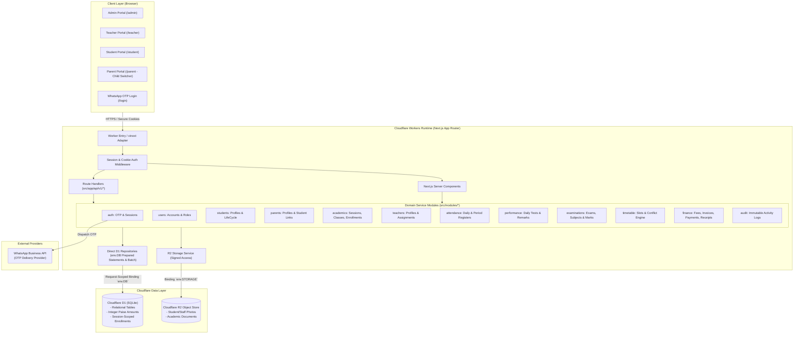

# System Architecture & Technical Design

**Project:** Student Management System (Coaching Institute + Mess Fee Management)  
**Document Version:** 2.0 (Phase 0 Aligned)  
**PRD Reference:** PRD v1.2 & Phase 0 Architecture Pack  
**Approved Stack:** Next.js App Router (JavaScript) · Cloudflare Workers · Cloudflare D1 (SQLite, Direct `env.DB` Bindings — No ORM) · Cloudflare R2 · Tailwind CSS + shadcn/ui · WhatsApp OTP  

---

## 1. Architectural Style & Boundaries

The application is structured as a **Modular Monolith** delivered within a single full-stack Next.js application deployed to **Cloudflare Workers**. 

* **Single Institution Scope (ADR-001):** Built for one coaching institute with mess fees as an integrated fee component. No multi-tenant complexity or separate database per module.
* **Unified Full-Stack Runtime (ADR-002):** UI and backend services reside in the same Next.js repository. No separate Express, NestJS, or external API gateways.
* **Edge-Native Deployment (ADR-004):** Hosted on Cloudflare Workers using the recommended adapter (**vinext** baseline, with **OpenNext** as evaluated fallback).
* **Serverless Storage & Data (ADR-005, ADR-007):** Cloudflare D1 (serverless SQLite) for relational state; Cloudflare R2 for binary assets (photos, documents).
* **JavaScript First (ADR-003):** All application code is standard `.js` and `.jsx` with JSDoc typing and Zod runtime schema validation.



---

## 2. Technology Stack & Operational Baseline

| Layer | Approved Technology | Decision Driver / Constraint |
| :--- | :--- | :--- |
| **Framework** | **Next.js (App Router)** | Full-stack architecture; Server Components for fast data rendering; Route Handlers for API. |
| **Language** | **JavaScript / JSX (`.js`, `.jsx`)** | Application code is strictly JavaScript; Zod schemas provide boundary validation; JSDoc provides IDE type hinting. |
| **Edge Runtime** | **Cloudflare Workers** | Ultra-low latency, serverless execution at edge. |
| **Deployment Adapter**| **vinext** (or **OpenNext**) | Cloudflare-recommended Next.js on Workers adapter. Tested via Phase 0 compatibility spike. |
| **Database** | **Cloudflare D1 (SQLite)** | Serverless, relational, transactional SQLite. Queries executed via request-scoped `env.DB` binding. |
| **Data Access & Migrations** | **Direct Workers `env.DB` + Wrangler SQL Migrations** | Zero ORM overhead; parameterized `env.DB.prepare().bind()` and atomic `env.DB.batch([...])` inside `*.repository.js`, with native `migrations/*.sql` tracked in `d1_migrations`. |
| **File Storage** | **Cloudflare R2** | S3-compatible, zero-egress object storage for photos/documents; metadata in D1. |
| **UI Components** | **Tailwind CSS + shadcn/ui** | Accessible Radix UI primitives, utility-first styling, responsive across desktop and tablet. |
| **Form & Validation** | **React Hook Form + Zod** | Declarative forms, robust client and server schema validation. |
| **Authentication** | **WhatsApp OTP** | Phone-number based OTP challenges with provider abstraction, single-use hashed verification, HttpOnly session cookies. |

---

## 3. Modular Monolith Codebase Structure

In accordance with Phase 0 guidelines, application code resides in a clean modular layout (`src/`):

```text
student-management/
├── src/
│   ├── app/                    # Next.js App Router pages and route handlers
│   │   ├── (auth)/             # Login, OTP verification routes
│   │   │   ├── login/page.jsx
│   │   │   └── verify-otp/page.jsx
│   │   ├── (admin)/            # Admin portal routes
│   │   ├── (teacher)/          # Teacher portal routes
│   │   ├── (student)/          # Student portal routes
│   │   ├── (parent)/           # Parent portal (with Child Switcher)
│   │   ├── api/                # API Route Handlers
│   │   │   └── v1/             # RESTful API endpoints (/api/v1/*)
│   │   ├── layout.jsx          # Root application shell
│   │   └── page.jsx            # Landing / auth redirect
│   │
│   ├── modules/                # Domain-driven feature modules
│   │   ├── auth/               # auth.service.js, auth.repository.js, auth.schemas.js
│   │   ├── users/              # Account and role management
│   │   ├── students/           # Profiles, admission numbers, life-cycle
│   │   ├── parents/            # Parent profiles, multi-child relationships
│   │   ├── academics/          # Sessions, classes, subjects, enrollments
│   │   ├── teachers/           # Staff profiles, session-scoped assignments
│   │   ├── attendance/         # Daily registers and period registers
│   │   ├── performance/        # Daily tests, homework, teacher remarks
│   │   ├── examinations/       # Exams, max/pass marks, results, grading
│   │   ├── timetable/          # Timetable slots and collision engine
│   │   ├── finance/            # Fee structures, invoices, payments, allocations, receipts
│   │   ├── reports/            # Academic & financial query views
│   │   └── audit/              # Immutable audit logging service
│   │
│   ├── components/             # Reusable UI widgets
│   │   ├── ui/                 # shadcn/ui base elements (buttons, dialogs, inputs)
│   │   ├── layout/             # Sidebar, topbar, child-switcher, portal shell
│   │   └── data-display/       # Data tables, stat cards, attendance registers
│   │
│   ├── lib/                    # Shared runtime helpers & integrations
│   │   ├── db/                 # Request-scoped D1 helpers (getDb, batch chunking, SQL utilities)
│   │   ├── cloudflare/         # Cloudflare bindings accessor (D1, R2)
│   │   ├── auth/               # Session cookie and token hashing utilities
│   │   ├── whatsapp/           # WhatsApp OTP provider adapter interface
│   │   ├── money/              # Integer paise math and INR formatting helpers
│   │   ├── validation/         # Common Zod validation rules
│   │   └── dates/              # ISO-8601 date utilities
│   │
│   └── config/                 # Static application configuration constants
│
├── migrations/                 # Native Wrangler D1 SQL migrations (d1_migrations)
│   └── 0001_initial_schema.sql # Committed SQLite DDL (includes PRAGMA foreign_keys = ON;)
│
├── seeds/                      # Synthetic development seed SQL (never run against production)
│   └── seed.sql                # Local synthetic fixtures applied via wrangler d1 execute
│
├── wrangler.toml               # Cloudflare Workers, D1 & R2 configuration
├── tailwind.config.js
├── package.json
└── README.md
```

---

## 4. Cloudflare D1 & Workers Execution Model

### 4.1 Request-Scoped Bindings & Direct D1 Repositories (No Global Singletons, No ORM)
Workers isolates execution per request. In accordance with `AGENTS.md`:
* Never capture request-specific `env.DB` or `env.STORAGE` bindings in a long-lived global singleton.
* Do **not** introduce any ORM or query-builder abstraction layer; every module repository (`src/modules/<domain>/<domain>.repository.js`) receives the request-scoped `env.DB` binding and executes parameterized SQL directly, paired with Zod schemas (`src/modules/<domain>/<domain>.schemas.js`) at domain/API boundaries:
  ```javascript
  // src/lib/db/client.js
  /**
   * Return the request-scoped Cloudflare D1 database binding.
   * @param {{ DB?: D1Database }} env
   * @returns {D1Database}
   */
  export function getDb(env) {
    if (!env?.DB) {
      throw new Error('Cloudflare D1 binding (env.DB) is not available.');
    }
    return env.DB;
  }
  ```
* **Prepared Statements & Query Execution:** Always use `db.prepare(sql).bind(...)` with positional `?` placeholders—never interpolate variables into SQL strings.
  ```javascript
  // src/modules/students/students.repository.js
  export async function findStudentById(db, studentId) {
    return await db
      .prepare('SELECT id, admission_number, full_name, lifecycle_status FROM students WHERE id = ?')
      .bind(studentId)
      .first();
  }

  export async function listActiveEnrollments(db, sessionId, classId, limit, offset) {
    const [countRes, rowsRes] = await db.batch([
      db.prepare('SELECT COUNT(*) AS total FROM enrollments WHERE academic_session_id = ? AND class_id = ? AND enrollment_status = ?')
        .bind(sessionId, classId, 'ACTIVE'),
      db.prepare('SELECT id, student_id, roll_number FROM enrollments WHERE academic_session_id = ? AND class_id = ? AND enrollment_status = ? ORDER BY roll_number ASC LIMIT ? OFFSET ?')
        .bind(sessionId, classId, 'ACTIVE', limit, offset),
    ]);
    return {
      total: countRes.results[0]?.total ?? 0,
      rows: rowsRes.results,
    };
  }
  ```

### 4.2 SQLite & D1 Concurrency Constraints
* **Single-Threaded Writes & Read-After-Write Consistency:** Each Cloudflare D1 database processes writes serially. Always query primary `env.DB` for read-after-write, financial, and authentication checks.
* **Atomic Batch Operations for Financial Integrity:** Critical multi-step writes (e.g., generating invoice + items, recording payment + allocations + receipt + invoice status update) must use `env.DB.batch([...])` so all statements execute in a single round trip and either all commit or all roll back atomically. Chunk batches when exceeding D1 limits (1,000 statements on free tier, 10,000 on paid plans).
* **SQLite Types, Foreign Keys & Limits:** Bind integers `1` / `0` for SQLite booleans, `TEXT` ISO-8601 strings for dates/timestamps, and integer paise for money. Enforce `PRAGMA foreign_keys = ON;` in migrations and tests, index `WHERE`/`JOIN` columns, avoid N+1 query loops, paginate collections, and keep all binary files in Cloudflare R2 (D1 max row size is 1 MB).

---

## 5. Security & Authorization Architecture

1. **Deny-by-Default Server Verification:** Route handlers and domain services inspect the authenticated session on every request. Client-side navigation merely toggles UI.
2. **Parent Access Boundary:** Every parent request must join through `parent_students` and enforce `parent_id = session.parentId`.
3. **Teacher Access Boundary:** Teachers may access only the students, classes, and subjects assigned to them in the active academic session.
4. **Student Fee Wall:** Students have zero access to fee routes. Student fee requests return HTTP `403 Forbidden`.
5. **Secure Session Cookies:** Sessions are tracked via encrypted/signed, `HttpOnly`, `SameSite=Lax` (or `Strict`), `Secure` cookies.
6. **R2 Object Protection:** File access is authorized through server route handlers or short-lived presigned URLs. Private R2 keys are never leaked to the client.
