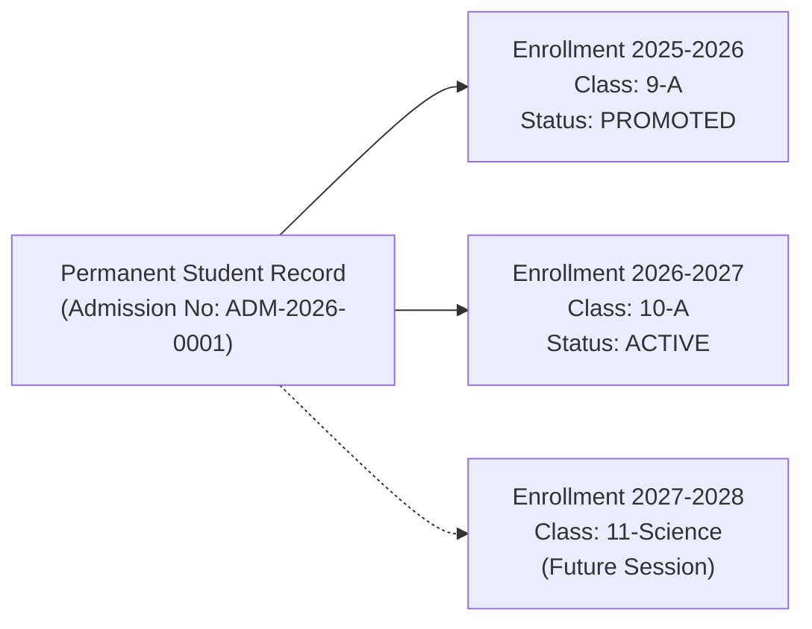

# Business Rules & Domain Logic Specification

**Project:** Student Management System (Coaching Institute + Mess Fee Management)  
**PRD Reference:** PRD v1.2, Backlog, & Phase 0 Architecture Pack  
**Document Version:** 2.0 (Phase 0 Aligned)  

---

## 1. Role-Based Permissions & Access Matrix

Enforcement is mandatory on the server side across all route handlers and domain services. UI controls merely reflect granted capabilities.

| Capability | Super Admin | Coaching Admin | Teacher | Student | Parent |
| :--- | :---: | :---: | :---: | :---: | :---: |
| System Settings & Institute Profile | **Manage** | View Only / OPEN | No | No | No |
| Create / Deactivate User Accounts | **Manage** | Limited / OPEN | No | No | No |
| Audit Logs | **Full** | Limited / OPEN | No | No | No |
| Student Admissions & Profiles | **Manage** | **Manage** | Assigned View | Own View | Linked View |
| Academic Sessions & Rollover | **Manage** | **Manage** | Assigned View | Own Session | Linked Session |
| Class & Subject Configuration | **Manage** | **Manage** | Assigned View | Own Class | Linked Class |
| Teacher Profiles & Assignments | **Manage** | **Manage** | Own View | No | No |
| Daily Attendance Register | **Manage** | **Manage** | Class Teacher | Own View | Linked View |
| Period Attendance Register | **Manage** | **Manage** | Regular Teacher | Own View | Linked View |
| Daily Performance & Remarks | **Manage** | **Manage** | Assigned Create | Own View | Linked View |
| Exam Setup & Max Marks | **Manage** | **Manage** | Assigned Input | No | No |
| Exam Marks Entry | **Manage** | **Manage** | Authorized Marks | Own Results | Linked Results |
| Timetable Configuration | **Manage** | **Manage** | Own View | Class View | Linked View |
| Fee Structures & Overrides | **Manage** | **Manage** | No | No | No |
| Invoices & Payment Recording | **Manage** | **Manage** | No | No | No |
| Student Fee Visibility | **Full** | **Full** | Assigned Read-Only | **FORBIDDEN** | Linked Read-Only |
| Download Receipts & Invoices | **Yes** | **Yes** | View Only | No | View / Print |

---

## 2. Authentication & WhatsApp OTP Lifecycle

In accordance with ADR-008 and PRD v1.2, authentication is passwordless via verified WhatsApp OTP.

### 2.1 OTP Challenge Flow
1. **Request:** User enters phone number. The system normalizes to E.164 (e.g., `+919876543210`).
2. **Account Guard:** The system checks if the user exists and is active.
   * *Anti-Enumeration Rule:* The API returns the exact same generic response regardless of whether the phone number is registered.
3. **Challenge Generation:**
   * Generates a cryptographically secure 6-digit random code.
   * Computes an Argon2/SHA-256 hash of the code; **only the hash is persisted** in `otp_challenges`.
   * Sets `expires_at = now() + 5 minutes` and `attempts = 0`.
4. **Delivery:** The WhatsApp provider adapter formats the approved template and dispatches the code.
5. **Verification:**
   * Max 3 verification attempts per challenge.
   * Upon successful match, mark `consumed_at = now()` (single-use).
   * Issues a signed, secure, `HttpOnly` session cookie pointing to an active record in `sessions`.
6. **Throttling & Abuse Controls:**
   * Cooldown: 60 seconds between OTP requests per phone number.
   * Rate limit: Maximum 5 OTP requests per hour per IP.

---

## 3. Academic Sessions & Enrollment History

A critical Phase 0 architectural requirement is that student class placement is **session-based**, preserving complete academic history across years.



* **Permanent Identity:** The `students` table holds biographical data (DOB, blood group, emergency contact) and the unique `admission_number`.
* **Session Enrollment:** The `enrollments` table links the student to an `academic_session` and a `class`.
* **Attendance, Marks & Overrides Link to Enrollment:** Daily attendance, period attendance, performance remarks, and exam marks reference `enrollment_id`.
* **Promotion & Rollover:** When an academic session ends:
  * Existing enrollment status updates to `PROMOTED`, `REPEATED`, or `LEFT`.
  * A new `enrollment` record is created in the new academic session.
  * Historical reports for previous sessions remain 100% accurate and tamper-proof.

---

## 4. Teacher Responsibilities & Scoping

Teacher roles (`REGULAR_TEACHER` vs `CLASS_TEACHER`) are defined **per assignment**, not on the teacher profile.

* **Regular Teacher Assignment:**
  * Assigned to teach a specific subject in a class (e.g. Class 9 Mathematics).
  * Authorized to enter daily class test marks, evaluate homework/assignments, and add performance remarks for students in that subject.
  * Authorized to record period-wise attendance for that subject.
* **Class Teacher Assignment:**
  * Appointed steward of an entire class (e.g. Class 10 Class Teacher).
  * Authorized to record official institutional **Daily Attendance** (`attendance_days`).
  * Authorized to review consolidated progress and view student fee statuses for all students in that class.
* **Teacher Fee Visibility Scope:**
  * Teachers can view fee summaries (Total, Paid, Pending, Overdue) **only for students currently enrolled in their assigned classes for the active session**.
  * Teachers cannot view fees for other classes or past students.

---

## 5. Dual Attendance Register Segregation

To eliminate double-counting of absences:
1. **Daily Institutional Attendance:**
   * One record per enrollment per date in `attendance_days` & `daily_attendance_records`.
   * Marked by the assigned `CLASS_TEACHER` or Admin.
   * Official institutional attendance percentage is calculated solely from this table.
2. **Period Attendance:**
   * One record per enrollment per subject period in `period_attendance_registers` & `period_attendance_records`.
   * Marked by the subject's `REGULAR_TEACHER`.
   * Used for subject-level engagement tracking and absenteeism alerts.
3. **Locking & Corrections:**
   * Teachers may edit attendance until 11:59 PM on the attendance date.
   * Beyond 24 hours, the register locks (`is_locked = 1`). Corrections require Admin approval and log an immutable entry in `audit_logs`.

---

## 6. Integer Paise Financial Ledger & Allocation Rules

All financial calculations use **integer paise** (`1 INR = 100 paise`). Floating-point arithmetic is strictly forbidden.

### 6.1 Pricing Precedence
$$\text{Charge Paise}(E, C) = \begin{cases} 
\text{custom\_amount\_paise}, & \text{if record in } \text{student\_fee\_assignments}(E, C) \\
\text{default\_amount\_paise}, & \text{from } \text{fee\_structures}(\text{Class}(E), C)
\end{cases}$$

### 6.2 Invoice Generation
* **Billing Cycle:** Invoices are generated monthly on the 1st of the month with a configured due date (default: 10th).
* **Billing Options:**
  * **Combined Invoice (`COMBINED`):** Generates one invoice with line items for Coaching, Mess, and Other Charges.
  * **Separate Invoices (`SEPARATE_COACHING`, `SEPARATE_MESS`):** Generates independent invoices for tuition and mess fees.
* **Snapshot Immutability:** Line items in `invoice_items` store the exact amount charged at generation time. Changes to fee structures do not retroactively alter issued invoices.

### 6.3 Double-Entry Payment Allocation
* A `Payment` records money received from a student via Cash, UPI, or Bank Transfer.
* A `PaymentAllocation` maps funds directly to one or more invoices.
* **Invoice Balance Formulas:**
  $$\text{Allocated Paise}(\text{Invoice } I) = \sum \text{allocated\_amount\_paise}$$
  $$\text{Outstanding Paise}(\text{Invoice } I) = \text{total\_amount\_paise} - \text{Allocated Paise}(I)$$
* **Invoice Status Transitions:**
  * If $\text{Allocated Paise} = \text{total\_amount\_paise}$: `PAID`
  * If $0 < \text{Allocated Paise} < \text{total\_amount\_paise}$: `PARTIALLY_PAID`
  * If $\text{Allocated Paise} = 0$: `UNPAID`
  * *Derived Condition:* If $\text{Outstanding Paise} > 0$ and $\text{Current Date} > \text{due\_date}$, the invoice is flagged as **OVERDUE**.

---

## 7. Parent–Student Multi-Child Linking & Scoped Visibility

* **Multi-Child Linkage:** One parent WhatsApp number can be linked to multiple sibling students through `parent_students`.
* **Child Context Switcher:** The parent portal maintains an active student context.
* **Server-Side Security Invariant:**
  ```sql
  SELECT 1 FROM parent_students 
  WHERE parent_profile_id = :parentId AND student_id = :targetStudentId 
    AND verification_status = 'VERIFIED';
  ```
  If no verified link exists, the server returns HTTP `403 Forbidden`.
* **Read-Only Guarantee:** Parents can view academic progress, attendance, and fee invoices/receipts, but have **no mutation or payment recording capabilities**.

---

## 8. Unresolved Decisions (From PRD v1.2 / Backlog)

In accordance with `AGENTS.md` operating rules, these 15 items are **explicitly unresolved** and must be approved by stakeholders before implementing the affected modules:

1. **Super Admin vs Coaching Admin Permissions:** Exact boundary differences (e.g. whether Coaching Admin can delete student records or view audit logs).
2. **WhatsApp Business Provider:** Pinned provider choice (Meta Cloud API, Twilio, Infobip) and sandbox credentials.
3. **Account Provisioning:** Whether teacher and student profiles are invited by SMS/WhatsApp or manually activated.
4. **Parent Account Verification:** Process to verify that a mobile number belongs to the legal guardian upon admission.
5. **Dual Parent Accounts:** Whether both father and mother can hold separate portal accounts for the same student.
6. **Academic Calendar & Rollover:** Specific dates for session rollover, terms, and holiday calendars.
7. **Promotion / Retention Workflow:** Approval workflow for advancing students to the next grade or retaining them.
8. **Attendance Late Thresholds & Leave Approvals:** Grace period before marking 'Late' and formal leave request approvals.
9. **Grading Scales & Printable Report Cards:** Pass criteria formulas, grading scale boundaries, and whether PDF report cards are mandatory for pilot.
10. **Fee Concessions, Late Fines & Discounts:** Operational rules for sibling discounts, scholarship waivers, and late payment penalties.
11. **Bulk Invoicing & Numbering Scheme:** Standardized invoice prefix format (e.g. `INV-YYYYMM-XXXX`) and receipt numbering sequence.
12. **Historical Fee Visibility for Teachers:** Whether teachers can see fee data for students who left their class.
13. **Capacity & Volume Projections:** Expected student count (e.g. 200 vs 2000) and concurrent attendance marking load.
14. **Production Budget & RPO/RTO:** Cloudflare Workers plan requirements and database backup restore time objectives.
15. **Data Retention & Privacy Policy:** Policy for archiving records of alumni and students who have left.
