# Database Schema & Data Models Specification

**Project:** Student Management System (Coaching Institute + Mess Fee Management)  
**Database Engine:** 8× Cloudflare D1 (SQLite) — `DB_IDENTITY`, `DB_STUDENTS`, `DB_ACADEMICS`, `DB_ATTENDANCE`, `DB_PERFORMANCE`, `DB_FINANCE`, `DB_TIMETABLE`, `DB_AUDIT`  
**Data Access:** Direct Workers Domain Bindings (`getDomainDb(env, D1_BINDINGS.<DOMAIN>)`: `prepare().bind()`, `batch()`) — No ORM  
**Migrations:** 8 Independent Native Wrangler D1 SQL Tracks (`migrations/<domain>/*.sql`)  
**Authoritative Phase A Spec:** [PHASE_A_DATABASE_ARCHITECTURE_PROPOSAL.md](./PHASE_A_DATABASE_ARCHITECTURE_PROPOSAL.md) (45 tables, `ON DELETE RESTRICT` on historical tables, no cross-D1 FKs)  
**Document Version:** 2.1 (Phase A 8-D1 Aligned)  

---

## 1. Database Conventions & SQLite Specifics

1. **Database:** Cloudflare D1 (SQLite). Strict adherence to SQLite types and limitations.
2. **Primary Keys:** Application-generated UUID v4 strings (`TEXT PRIMARY KEY`).
3. **Monetary Values:** **Integer Paise** (`INTEGER NOT NULL`). ₹1,500.00 is stored as `150000`. Floating-point values for money are strictly forbidden.
4. **Timestamps:** UTC ISO-8601 strings (`TEXT`) or Unix epoch milliseconds. Recommended: ISO-8601 strings (e.g., `2026-11-23T18:15:00.000Z`).
5. **Dates:** ISO-8601 calendar date strings `YYYY-MM-DD` (e.g., `2026-11-23`).
6. **Booleans:** SQLite integer booleans (`0` for false, `1` for true). Always pass `1` or `0` (not JS booleans) when binding parameters via `env.DB.prepare(...).bind(...)`.
7. **Referential Integrity:** Foreign keys are explicitly defined in SQLite DDL and enforced via `PRAGMA foreign_keys = ON;`. No cascading deletions on historical academic or financial ledger records (`ON DELETE RESTRICT`).
8. **Historical Immutability & D1 Limits:** Student enrollment records, invoice snapshots, payment allocations, exam marks, and attendance registers preserve history across academic sessions. Keep D1 rows well under the 1 MB row limit by storing binary assets in R2 (`file_objects` holds metadata only).

---

## 2. Conceptual Entity-Relationship Diagram

```mermaid
erDiagram
    USERS ||--o{ USER_ROLES : has
    ROLES ||--o{ USER_ROLES : assigned
    USERS ||--o| TEACHER_PROFILES : may_have
    USERS ||--o| PARENT_PROFILES : may_have
    PARENT_PROFILES ||--o{ PARENT_STUDENTS : links
    STUDENTS ||--o{ PARENT_STUDENTS : linked_to
    
    STUDENTS ||--o{ ENROLLMENTS : has
    ACADEMIC_SESSIONS ||--o{ ENROLLMENTS : contains
    CLASSES ||--o{ ENROLLMENTS : places
    
    ACADEMIC_SESSIONS ||--o{ CLASS_SUBJECTS : offers
    CLASSES ||--o{ CLASS_SUBJECTS : has
    SUBJECTS ||--o{ CLASS_SUBJECTS : included
    
    TEACHER_PROFILES ||--o{ TEACHER_ASSIGNMENTS : receives
    ACADEMIC_SESSIONS ||--o{ TEACHER_ASSIGNMENTS : scopes
    CLASSES ||--o{ TEACHER_ASSIGNMENTS : assigned
    SUBJECTS ||--o{ TEACHER_ASSIGNMENTS : teaches
    
    ATTENDANCE_DAYS ||--o{ DAILY_ATTENDANCE_RECORDS : contains
    ENROLLMENTS ||--o{ DAILY_ATTENDANCE_RECORDS : recorded_for
    
    PERIOD_ATTENDANCE_REGISTERS ||--o{ PERIOD_ATTENDANCE_RECORDS : contains
    ENROLLMENTS ||--o{ PERIOD_ATTENDANCE_RECORDS : recorded_for
    
    ENROLLMENTS ||--o{ PERFORMANCE_RECORDS : has
    TEACHER_PROFILES ||--o{ PERFORMANCE_RECORDS : evaluates
    
    ACADEMIC_SESSIONS ||--o{ EXAMINATIONS : schedules
    EXAMINATIONS ||--o{ EXAM_SUBJECTS : contains
    EXAM_SUBJECTS ||--o{ EXAM_MARKS : records
    ENROLLMENTS ||--o{ EXAM_MARKS : earns
    
    CLASSES ||--o{ TIMETABLE_SLOTS : schedules
    SUBJECTS ||--o{ TIMETABLE_SLOTS : covers
    TEACHER_PROFILES ||--o{ TIMETABLE_SLOTS : teaches
    
    ENROLLMENTS ||--o{ STUDENT_FEE_ASSIGNMENTS : has
    STUDENTS ||--o{ INVOICES : billed
    INVOICES ||--|{ INVOICE_ITEMS : contains
    STUDENTS ||--o{ PAYMENTS : makes
    PAYMENTS ||--o{ PAYMENT_ALLOCATIONS : allocated
    INVOICES ||--o{ PAYMENT_ALLOCATIONS : receives
    PAYMENTS ||--o| RECEIPTS : documented
    
    USERS ||--o{ AUDIT_LOGS : performs
    USERS ||--o{ FILE_OBJECTS : owns
```



---

## 3. Entity Catalogue & Table Specifications

### 3.1 Identity, Users & WhatsApp Authentication

#### `users`
* `id`: `TEXT PRIMARY KEY` (UUID v4)
* `phone_normalized`: `TEXT NOT NULL UNIQUE` (e.g., `+919876543210`)
* `email`: `TEXT` (Nullable, unique where provided)
* `is_active`: `INTEGER NOT NULL DEFAULT 1`
* `created_at`: `TEXT NOT NULL`
* `updated_at`: `TEXT NOT NULL`

#### `roles`
* `id`: `TEXT PRIMARY KEY`
* `name`: `TEXT NOT NULL UNIQUE` (`SUPER_ADMIN`, `COACHING_ADMIN`, `TEACHER`, `STUDENT`, `PARENT`)
* `description`: `TEXT`

#### `user_roles`
* `id`: `TEXT PRIMARY KEY`
* `user_id`: `TEXT NOT NULL REFERENCES users(id) ON DELETE CASCADE`
* `role_id`: `TEXT NOT NULL REFERENCES roles(id) ON DELETE CASCADE`
* *Unique:* `(user_id, role_id)`

#### `otp_challenges`
* `id`: `TEXT PRIMARY KEY`
* `phone_normalized`: `TEXT NOT NULL`
* `otp_hash`: `TEXT NOT NULL` (Argon2 / SHA-256 hash of random 6-digit OTP)
* `expires_at`: `TEXT NOT NULL` (5-minute lifetime)
* `attempts`: `INTEGER NOT NULL DEFAULT 0` (Max 3 attempts)
* `consumed_at`: `TEXT` (Nullable; set on successful verification)
* `delivery_status`: `TEXT NOT NULL DEFAULT 'PENDING'` (`PENDING`, `DELIVERED`, `FAILED`)
* `created_at`: `TEXT NOT NULL`

#### `sessions`
* `id`: `TEXT PRIMARY KEY`
* `user_id`: `TEXT NOT NULL REFERENCES users(id) ON DELETE CASCADE`
* `token_hash`: `TEXT NOT NULL UNIQUE` (Hashed session identifier)
* `expires_at`: `TEXT NOT NULL` (e.g. 7-day rolling expiry)
* `revoked_at`: `TEXT` (Nullable)
* `user_agent`: `TEXT`
* `ip_address`: `TEXT`
* `created_at`: `TEXT NOT NULL`

---

### 3.2 Students, Parents & Academic Life-Cycle

#### `students`
Permanent institutional identity of the student.
* `id`: `TEXT PRIMARY KEY`
* `user_id`: `TEXT UNIQUE REFERENCES users(id) ON DELETE SET NULL` (Optional student portal login)
* `admission_number`: `TEXT NOT NULL UNIQUE` (e.g., `ADM-2026-0001`)
* `full_name`: `TEXT NOT NULL`
* `date_of_birth`: `TEXT NOT NULL` (`YYYY-MM-DD`)
* `gender`: `TEXT NOT NULL` (`Male`, `Female`, `Other`)
* `blood_group`: `TEXT`
* `photo_file_id`: `TEXT REFERENCES file_objects(id) ON DELETE SET NULL`
* `contact_phone`: `TEXT`
* `residential_address`: `TEXT`
* `emergency_contact_name`: `TEXT NOT NULL`
* `emergency_contact_phone`: `TEXT NOT NULL`
* `lifecycle_status`: `TEXT NOT NULL DEFAULT 'ACTIVE'` (`ACTIVE`, `INACTIVE`, `ALUMNI`, `LEFT`)
* `admission_date`: `TEXT NOT NULL`
* `created_at`: `TEXT NOT NULL`

#### `parent_profiles`
* `id`: `TEXT PRIMARY KEY`
* `user_id`: `TEXT NOT NULL UNIQUE REFERENCES users(id) ON DELETE CASCADE`
* `full_name`: `TEXT NOT NULL`
* `phone_normalized`: `TEXT NOT NULL`
* `email`: `TEXT`
* `relationship_type`: `TEXT NOT NULL` (`Father`, `Mother`, `Guardian`)
* `created_at`: `TEXT NOT NULL`

#### `parent_students`
Many-to-many relationship supporting multi-child families.
* `id`: `TEXT PRIMARY KEY`
* `parent_profile_id`: `TEXT NOT NULL REFERENCES parent_profiles(id) ON DELETE CASCADE`
* `student_id`: `TEXT NOT NULL REFERENCES students(id) ON DELETE CASCADE`
* `is_primary`: `INTEGER NOT NULL DEFAULT 1`
* `verification_status`: `TEXT NOT NULL DEFAULT 'VERIFIED'` (`VERIFIED`, `PENDING`)
* *Unique:* `(parent_profile_id, student_id)`

#### `academic_sessions`
Represents an academic year or coaching batch session (e.g., "2026-2027").
* `id`: `TEXT PRIMARY KEY`
* `name`: `TEXT NOT NULL UNIQUE` (e.g., `2026-2027`)
* `start_date`: `TEXT NOT NULL` (`YYYY-MM-DD`)
* `end_date`: `TEXT NOT NULL` (`YYYY-MM-DD`)
* `is_active`: `INTEGER NOT NULL DEFAULT 0`
* `created_at`: `TEXT NOT NULL`

#### `classes`
* `id`: `TEXT PRIMARY KEY`
* `name`: `TEXT NOT NULL` (e.g., `Class 10`)
* `grade_level`: `INTEGER NOT NULL` (e.g., `10`)
* `section`: `TEXT` (e.g., `A`)
* *Unique:* `(name, section)`

#### `subjects`
* `id`: `TEXT PRIMARY KEY`
* `name`: `TEXT NOT NULL`
* `code`: `TEXT NOT NULL UNIQUE` (e.g., `MATH-10`)
* `created_at`: `TEXT NOT NULL`

#### `class_subjects`
Subjects offered for a class in a specific academic session.
* `id`: `TEXT PRIMARY KEY`
* `academic_session_id`: `TEXT NOT NULL REFERENCES academic_sessions(id) ON DELETE CASCADE`
* `class_id`: `TEXT NOT NULL REFERENCES classes(id) ON DELETE CASCADE`
* `subject_id`: `TEXT NOT NULL REFERENCES subjects(id) ON DELETE RESTRICT`
* *Unique:* `(academic_session_id, class_id, subject_id)`

#### `enrollments`
Historical placement linking a student to a class for a specific academic session.
* `id`: `TEXT PRIMARY KEY`
* `student_id`: `TEXT NOT NULL REFERENCES students(id) ON DELETE RESTRICT`
* `academic_session_id`: `TEXT NOT NULL REFERENCES academic_sessions(id) ON DELETE RESTRICT`
* `class_id`: `TEXT NOT NULL REFERENCES classes(id) ON DELETE RESTRICT`
* `roll_number`: `TEXT`
* `enrollment_status`: `TEXT NOT NULL DEFAULT 'ACTIVE'` (`ACTIVE`, `PROMOTED`, `REPEATED`, `TRANSFERRED`, `LEFT`)
* `start_date`: `TEXT NOT NULL`
* `end_date`: `TEXT`
* *Unique:* `(student_id, academic_session_id)`

---

### 3.3 Teachers & Scoped Assignments

#### `teacher_profiles`
* `id`: `TEXT PRIMARY KEY`
* `user_id`: `TEXT NOT NULL UNIQUE REFERENCES users(id) ON DELETE CASCADE`
* `employee_code`: `TEXT NOT NULL UNIQUE` (e.g., `TCH-001`)
* `full_name`: `TEXT NOT NULL`
* `qualification`: `TEXT`
* `specialization`: `TEXT`
* `joining_date`: `TEXT NOT NULL`
* `employment_status`: `TEXT NOT NULL DEFAULT 'ACTIVE'` (`ACTIVE`, `INACTIVE`, `LEFT`)
* `photo_file_id`: `TEXT REFERENCES file_objects(id) ON DELETE SET NULL`
* `created_at`: `TEXT NOT NULL`

#### `teacher_assignments`
Scopes a teacher's responsibilities to a class and subject for an academic session.
* `id`: `TEXT PRIMARY KEY`
* `teacher_profile_id`: `TEXT NOT NULL REFERENCES teacher_profiles(id) ON DELETE CASCADE`
* `academic_session_id`: `TEXT NOT NULL REFERENCES academic_sessions(id) ON DELETE CASCADE`
* `class_id`: `TEXT NOT NULL REFERENCES classes(id) ON DELETE CASCADE`
* `subject_id`: `TEXT NOT NULL REFERENCES subjects(id) ON DELETE RESTRICT`
* `responsibility_category`: `TEXT NOT NULL` (`REGULAR_TEACHER`, `CLASS_TEACHER`)
* *Unique:* `(teacher_profile_id, academic_session_id, class_id, subject_id, responsibility_category)`

---

### 3.4 Attendance & Daily Performance

#### `attendance_days` (Daily Institutional Register)
* `id`: `TEXT PRIMARY KEY`
* `academic_session_id`: `TEXT NOT NULL REFERENCES academic_sessions(id) ON DELETE RESTRICT`
* `class_id`: `TEXT NOT NULL REFERENCES classes(id) ON DELETE CASCADE`
* `attendance_date`: `TEXT NOT NULL` (`YYYY-MM-DD`)
* `marked_by_teacher_id`: `TEXT REFERENCES teacher_profiles(id) ON DELETE SET NULL`
* `is_locked`: `INTEGER NOT NULL DEFAULT 0`
* `created_at`: `TEXT NOT NULL`
* *Unique:* `(academic_session_id, class_id, attendance_date)`

#### `daily_attendance_records`
* `id`: `TEXT PRIMARY KEY`
* `attendance_day_id`: `TEXT NOT NULL REFERENCES attendance_days(id) ON DELETE CASCADE`
* `enrollment_id`: `TEXT NOT NULL REFERENCES enrollments(id) ON DELETE CASCADE`
* `status`: `TEXT NOT NULL` (`PRESENT`, `ABSENT`, `LATE`, `LEAVE`)
* `remarks`: `TEXT`
* `created_at`: `TEXT NOT NULL`
* *Unique:* `(attendance_day_id, enrollment_id)`

#### `period_attendance_registers` (Period-Wise Register)
* `id`: `TEXT PRIMARY KEY`
* `academic_session_id`: `TEXT NOT NULL REFERENCES academic_sessions(id) ON DELETE RESTRICT`
* `class_id`: `TEXT NOT NULL REFERENCES classes(id) ON DELETE CASCADE`
* `subject_id`: `TEXT NOT NULL REFERENCES subjects(id) ON DELETE RESTRICT`
* `attendance_date`: `TEXT NOT NULL` (`YYYY-MM-DD`)
* `period_number`: `INTEGER NOT NULL`
* `marked_by_teacher_id`: `TEXT REFERENCES teacher_profiles(id) ON DELETE SET NULL`
* `created_at`: `TEXT NOT NULL`
* *Unique:* `(academic_session_id, class_id, subject_id, attendance_date, period_number)`

#### `period_attendance_records`
* `id`: `TEXT PRIMARY KEY`
* `register_id`: `TEXT NOT NULL REFERENCES period_attendance_registers(id) ON DELETE CASCADE`
* `enrollment_id`: `TEXT NOT NULL REFERENCES enrollments(id) ON DELETE CASCADE`
* `status`: `TEXT NOT NULL` (`PRESENT`, `ABSENT`, `LATE`, `LEAVE`)
* `remarks`: `TEXT`
* *Unique:* `(register_id, enrollment_id)`

#### `performance_records` (Daily Class Tests, Homework, Remarks)
* `id`: `TEXT PRIMARY KEY`
* `enrollment_id`: `TEXT NOT NULL REFERENCES enrollments(id) ON DELETE CASCADE`
* `teacher_profile_id`: `TEXT NOT NULL REFERENCES teacher_profiles(id) ON DELETE RESTRICT`
* `subject_id`: `TEXT REFERENCES subjects(id) ON DELETE RESTRICT`
* `evaluation_date`: `TEXT NOT NULL` (`YYYY-MM-DD`)
* `category`: `TEXT NOT NULL` (`CLASS_TEST`, `HOMEWORK`, `CLASSWORK`, `GENERAL`)
* `marks_obtained`: `REAL` (Optional numeric score)
* `max_marks`: `REAL` (Optional maximum score)
* `remarks`: `TEXT NOT NULL`
* `created_at`: `TEXT NOT NULL`

---

### 3.5 Examinations & Results

#### `examinations`
* `id`: `TEXT PRIMARY KEY`
* `academic_session_id`: `TEXT NOT NULL REFERENCES academic_sessions(id) ON DELETE RESTRICT`
* `name`: `TEXT NOT NULL` (e.g., `Half-Yearly Examination 2026`)
* `exam_type`: `TEXT NOT NULL` (`UNIT_TEST`, `MONTHLY_TEST`, `HALF_YEARLY`, `FINAL`)
* `start_date`: `TEXT NOT NULL`
* `end_date`: `TEXT NOT NULL`
* `is_published`: `INTEGER NOT NULL DEFAULT 0`
* `created_at`: `TEXT NOT NULL`

#### `exam_subjects`
* `id`: `TEXT PRIMARY KEY`
* `examination_id`: `TEXT NOT NULL REFERENCES examinations(id) ON DELETE CASCADE`
* `class_id`: `TEXT NOT NULL REFERENCES classes(id) ON DELETE CASCADE`
* `subject_id`: `TEXT NOT NULL REFERENCES subjects(id) ON DELETE RESTRICT`
* `exam_date`: `TEXT NOT NULL`
* `max_marks`: `REAL NOT NULL` (e.g., `100.0`)
* `passing_marks`: `REAL NOT NULL` (e.g., `35.0`)
* *Unique:* `(examination_id, class_id, subject_id)`

#### `exam_marks`
* `id`: `TEXT PRIMARY KEY`
* `exam_subject_id`: `TEXT NOT NULL REFERENCES exam_subjects(id) ON DELETE CASCADE`
* `enrollment_id`: `TEXT NOT NULL REFERENCES enrollments(id) ON DELETE CASCADE`
* `marks_obtained`: `REAL`
* `is_absent`: `INTEGER NOT NULL DEFAULT 0`
* `remarks`: `TEXT`
* `entered_by_teacher_id`: `TEXT REFERENCES teacher_profiles(id) ON DELETE SET NULL`
* `created_at`: `TEXT NOT NULL`
* *Unique:* `(exam_subject_id, enrollment_id)`

---

### 3.6 Timetable

#### `timetable_slots`
* `id`: `TEXT PRIMARY KEY`
* `academic_session_id`: `TEXT NOT NULL REFERENCES academic_sessions(id) ON DELETE CASCADE`
* `class_id`: `TEXT NOT NULL REFERENCES classes(id) ON DELETE CASCADE`
* `subject_id`: `TEXT NOT NULL REFERENCES subjects(id) ON DELETE RESTRICT`
* `teacher_profile_id`: `TEXT NOT NULL REFERENCES teacher_profiles(id) ON DELETE RESTRICT`
* `day_of_week`: `INTEGER NOT NULL` (1 = Monday, ..., 7 = Sunday)
* `period_number`: `INTEGER NOT NULL`
* `start_time`: `TEXT NOT NULL` (`HH:MM`)
* `end_time`: `TEXT NOT NULL` (`HH:MM`)
* `room_name`: `TEXT`
* *Uniqueness & Collision Constraints:*
  * Unique Class Slot: `(academic_session_id, class_id, day_of_week, period_number)`
  * Unique Teacher Slot: `(academic_session_id, teacher_profile_id, day_of_week, period_number)`

---

### 3.7 Finance & Integer Paise Ledger

#### `fee_components`
Master definition of fee heads.
* `id`: `TEXT PRIMARY KEY`
* `code`: `TEXT NOT NULL UNIQUE` (`COACHING`, `MESS`, `OTHER`)
* `name`: `TEXT NOT NULL`
* `description`: `TEXT`

#### `fee_structures`
Standard fee amounts per class and session.
* `id`: `TEXT PRIMARY KEY`
* `academic_session_id`: `TEXT NOT NULL REFERENCES academic_sessions(id) ON DELETE CASCADE`
* `class_id`: `TEXT NOT NULL REFERENCES classes(id) ON DELETE CASCADE`
* `fee_component_id`: `TEXT NOT NULL REFERENCES fee_components(id) ON DELETE RESTRICT`
* `default_amount_paise`: `INTEGER NOT NULL` (e.g., `150000` = ₹1,500.00)
* *Unique:* `(academic_session_id, class_id, fee_component_id)`

#### `student_fee_assignments`
Student enrollment-specific overrides or concessions.
* `id`: `TEXT PRIMARY KEY`
* `enrollment_id`: `TEXT NOT NULL REFERENCES enrollments(id) ON DELETE CASCADE`
* `fee_component_id`: `TEXT NOT NULL REFERENCES fee_components(id) ON DELETE RESTRICT`
* `custom_amount_paise`: `INTEGER NOT NULL`
* `reason`: `TEXT`
* `effective_from`: `TEXT NOT NULL`
* *Unique:* `(enrollment_id, fee_component_id)`

#### `invoices`
Snapshot bill generated for a student.
* `id`: `TEXT PRIMARY KEY`
* `invoice_number`: `TEXT NOT NULL UNIQUE` (e.g., `INV-202611-0001`)
* `student_id`: `TEXT NOT NULL REFERENCES students(id) ON DELETE RESTRICT`
* `enrollment_id`: `TEXT NOT NULL REFERENCES enrollments(id) ON DELETE RESTRICT`
* `billing_month`: `INTEGER NOT NULL` (1–12)
* `billing_year`: `INTEGER NOT NULL` (e.g., 2026)
* `invoice_type`: `TEXT NOT NULL` (`COMBINED`, `SEPARATE_COACHING`, `SEPARATE_MESS`)
* `total_amount_paise`: `INTEGER NOT NULL`
* `due_date`: `TEXT NOT NULL` (`YYYY-MM-DD`)
* `status`: `TEXT NOT NULL DEFAULT 'UNPAID'` (`PAID`, `PARTIALLY_PAID`, `UNPAID`)
* `created_at`: `TEXT NOT NULL`
* *Unique:* `(student_id, billing_month, billing_year, invoice_type)`

#### `invoice_items`
Itemized line snapshot of fee components included in an invoice.
* `id`: `TEXT PRIMARY KEY`
* `invoice_id`: `TEXT NOT NULL REFERENCES invoices(id) ON DELETE CASCADE`
* `fee_component_id`: `TEXT NOT NULL REFERENCES fee_components(id) ON DELETE RESTRICT`
* `description`: `TEXT NOT NULL`
* `amount_paise`: `INTEGER NOT NULL`

#### `payments`
Record of money received.
* `id`: `TEXT PRIMARY KEY`
* `student_id`: `TEXT NOT NULL REFERENCES students(id) ON DELETE RESTRICT`
* `amount_paid_paise`: `INTEGER NOT NULL`
* `payment_method`: `TEXT NOT NULL` (`CASH`, `UPI`, `BANK_TRANSFER`)
* `transaction_reference`: `TEXT` (UPI reference ID or bank UTR)
* `payment_date`: `TEXT NOT NULL` (`YYYY-MM-DD`)
* `notes`: `TEXT`
* `recorded_by_user_id`: `TEXT REFERENCES users(id) ON DELETE SET NULL`
* `created_at`: `TEXT NOT NULL`

#### `payment_allocations`
Maps payments to specific invoices. Supports partial payments and multiple invoices.
* `id`: `TEXT PRIMARY KEY`
* `payment_id`: `TEXT NOT NULL REFERENCES payments(id) ON DELETE CASCADE`
* `invoice_id`: `TEXT NOT NULL REFERENCES invoices(id) ON DELETE RESTRICT`
* `allocated_amount_paise`: `INTEGER NOT NULL`
* `created_at`: `TEXT NOT NULL`
* *Rule:* $\sum \text{allocated\_amount\_paise} \le \text{payment.amount\_paid\_paise}$

#### `receipts`
Formal printable receipt record.
* `id`: `TEXT PRIMARY KEY`
* `receipt_number`: `TEXT NOT NULL UNIQUE` (e.g., `REC-202611-0001`)
* `payment_id`: `TEXT NOT NULL UNIQUE REFERENCES payments(id) ON DELETE RESTRICT`
* `issued_date`: `TEXT NOT NULL`
* `created_at`: `TEXT NOT NULL`

---

### 3.8 Audit Logs & R2 File Metadata

#### `audit_logs`
* `id`: `TEXT PRIMARY KEY`
* `actor_user_id`: `TEXT REFERENCES users(id) ON DELETE SET NULL`
* `action`: `TEXT NOT NULL` (`CREATE`, `UPDATE`, `CORRECTION`, `ALLOCATION`, `REVERSAL`)
* `entity_type`: `TEXT NOT NULL` (`DAILY_ATTENDANCE`, `EXAM_MARKS`, `PAYMENT`, `INVOICE`)
* `entity_id`: `TEXT NOT NULL`
* `old_values`: `TEXT` (JSON serialized before-state)
* `new_values`: `TEXT` (JSON serialized after-state)
* `ip_address`: `TEXT`
* `created_at`: `TEXT NOT NULL`

#### `file_objects`
Metadata for binary assets stored in Cloudflare R2.
* `id`: `TEXT PRIMARY KEY`
* `r2_object_key`: `TEXT NOT NULL UNIQUE`
* `category`: `TEXT NOT NULL` (`STUDENT_PHOTO`, `TEACHER_PHOTO`, `DOCUMENT`)
* `mime_type`: `TEXT NOT NULL`
* `size_bytes`: `INTEGER NOT NULL`
* `uploaded_by_user_id`: `TEXT REFERENCES users(id) ON DELETE SET NULL`
* `created_at`: `TEXT NOT NULL`

---

## 4. Pure SQLite DDL & Direct D1 Repository Patterns

All database tables, constraints, and indexes are authored as pure SQLite DDL in `migrations/*.sql` (applied via Wrangler D1 migrations), while runtime input/output contracts are validated with Zod in `src/modules/*/*.schemas.js`.

### 4.1 SQLite DDL Excerpt (`migrations/0001_initial_schema.sql` — Finance Ledger)

```sql
PRAGMA foreign_keys = ON;

CREATE TABLE IF NOT EXISTS invoices (
  id TEXT PRIMARY KEY,
  invoice_number TEXT NOT NULL UNIQUE,
  student_id TEXT NOT NULL REFERENCES students(id) ON DELETE RESTRICT,
  enrollment_id TEXT NOT NULL REFERENCES enrollments(id) ON DELETE RESTRICT,
  billing_month INTEGER NOT NULL CHECK (billing_month BETWEEN 1 AND 12),
  billing_year INTEGER NOT NULL,
  invoice_type TEXT NOT NULL CHECK (invoice_type IN ('COMBINED', 'SEPARATE_COACHING', 'SEPARATE_MESS')),
  total_amount_paise INTEGER NOT NULL CHECK (total_amount_paise >= 0),
  due_date TEXT NOT NULL,
  status TEXT NOT NULL DEFAULT 'UNPAID' CHECK (status IN ('PAID', 'PARTIALLY_PAID', 'UNPAID')),
  created_at TEXT NOT NULL,
  UNIQUE (student_id, billing_month, billing_year, invoice_type)
);

CREATE TABLE IF NOT EXISTS invoice_items (
  id TEXT PRIMARY KEY,
  invoice_id TEXT NOT NULL REFERENCES invoices(id) ON DELETE CASCADE,
  fee_component_id TEXT NOT NULL REFERENCES fee_components(id) ON DELETE RESTRICT,
  description TEXT NOT NULL,
  amount_paise INTEGER NOT NULL CHECK (amount_paise >= 0)
);

CREATE TABLE IF NOT EXISTS payments (
  id TEXT PRIMARY KEY,
  student_id TEXT NOT NULL REFERENCES students(id) ON DELETE RESTRICT,
  amount_paid_paise INTEGER NOT NULL CHECK (amount_paid_paise > 0),
  payment_method TEXT NOT NULL CHECK (payment_method IN ('CASH', 'UPI', 'BANK_TRANSFER')),
  transaction_reference TEXT,
  payment_date TEXT NOT NULL,
  notes TEXT,
  recorded_by_user_id TEXT REFERENCES users(id) ON DELETE SET NULL,
  created_at TEXT NOT NULL
);

CREATE TABLE IF NOT EXISTS payment_allocations (
  id TEXT PRIMARY KEY,
  payment_id TEXT NOT NULL REFERENCES payments(id) ON DELETE CASCADE,
  invoice_id TEXT NOT NULL REFERENCES invoices(id) ON DELETE RESTRICT,
  allocated_amount_paise INTEGER NOT NULL CHECK (allocated_amount_paise > 0),
  created_at TEXT NOT NULL
);

CREATE TABLE IF NOT EXISTS receipts (
  id TEXT PRIMARY KEY,
  receipt_number TEXT NOT NULL UNIQUE,
  payment_id TEXT NOT NULL UNIQUE REFERENCES payments(id) ON DELETE RESTRICT,
  issued_date TEXT NOT NULL,
  created_at TEXT NOT NULL
);

CREATE INDEX IF NOT EXISTS idx_invoices_student_status ON invoices(student_id, status);
CREATE INDEX IF NOT EXISTS idx_invoices_due_date ON invoices(due_date) WHERE status != 'PAID';
CREATE INDEX IF NOT EXISTS idx_payments_student_date ON payments(student_id, payment_date);
CREATE INDEX IF NOT EXISTS idx_payment_allocations_invoice ON payment_allocations(invoice_id);
```

### 4.2 Direct D1 Repository + Zod Validation Example

```javascript
// src/modules/finance/finance.schemas.js
import { z } from 'zod';

export const recordPaymentSchema = z.object({
  studentId: z.string().uuid(),
  amountPaidPaise: z.number().int().positive(),
  paymentMethod: z.enum(['CASH', 'UPI', 'BANK_TRANSFER']),
  transactionReference: z.string().trim().min(1).optional(),
  paymentDate: z.string().regex(/^\d{4}-\d{2}-\d{2}$/),
  notes: z.string().trim().max(500).optional(),
  allocations: z.array(z.object({
    invoiceId: z.string().uuid(),
    allocatedAmountPaise: z.number().int().positive(),
  })).min(1),
});
```

```javascript
// src/modules/finance/finance.repository.js
/**
 * Atomically persist a payment, allocations, receipt, and invoice status updates.
 * D1 executes env.DB.batch([...]) as a single atomic transaction.
 */
export async function recordPaymentBatch(db, { payment, allocations, invoiceUpdates, receipt }) {
  const statements = [
    db.prepare(`
      INSERT INTO payments (
        id, student_id, amount_paid_paise, payment_method,
        transaction_reference, payment_date, notes, recorded_by_user_id, created_at
      ) VALUES (?, ?, ?, ?, ?, ?, ?, ?, ?)
    `).bind(
      payment.id,
      payment.studentId,
      payment.amountPaidPaise,
      payment.paymentMethod,
      payment.transactionReference ?? null,
      payment.paymentDate,
      payment.notes ?? null,
      payment.recordedByUserId,
      payment.createdAt,
    ),
    ...allocations.map((alloc) =>
      db.prepare(`
        INSERT INTO payment_allocations (id, payment_id, invoice_id, allocated_amount_paise, created_at)
        VALUES (?, ?, ?, ?, ?)
      `).bind(alloc.id, payment.id, alloc.invoiceId, alloc.allocatedAmountPaise, payment.createdAt),
    ),
    ...invoiceUpdates.map((inv) =>
      db.prepare('UPDATE invoices SET status = ? WHERE id = ?')
        .bind(inv.nextStatus, inv.invoiceId),
    ),
    db.prepare(`
      INSERT INTO receipts (id, receipt_number, payment_id, issued_date, created_at)
      VALUES (?, ?, ?, ?, ?)
    `).bind(receipt.id, receipt.receiptNumber, payment.id, receipt.issuedDate, receipt.createdAt),
  ];

  return await db.batch(statements);
}
```
