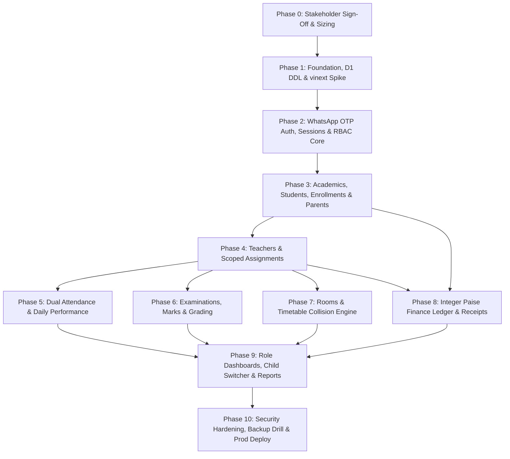

# End-to-End Development Roadmap (Phase 0 through Phase 10)

**Project:** Student Management System (Coaching Institute + Mess Fee Management)  
**Approved Stack:** Next.js App Router (`.js`/`.jsx` only) · Cloudflare Workers (`vinext`) · Cloudflare D1 (`env.DB` prepared statements & `env.DB.batch()`, zero ORM) · Native Wrangler SQL Migrations (`migrations/*.sql`) · Cloudflare R2 (`env.STORAGE`) · Tailwind CSS v4 + shadcn/ui · Zod + React Hook Form  
**Supporting Specs:** [SQL_DDL_BLUEPRINT.md](./SQL_DDL_BLUEPRINT.md) · [SECURITY_AND_RBAC_SPEC.md](./SECURITY_AND_RBAC_SPEC.md) · [OPEN_DECISIONS.md](./OPEN_DECISIONS.md) · [API_SPECIFICATION.md](./API_SPECIFICATION.md)  
**Document Version:** 1.0

---

## 1. Master Build Sequence & Critical Dependencies



### Non-Negotiable Engineering Rules Across Every Phase
1. **JavaScript/JSX Only in `src/` and `tests/`:** Zero `.ts` or `.tsx` files in application or test directories (`vinext build` auto-generates ambient `next-env.d.ts` at root only).
2. **Zero ORMs & Zero Forbidden Backends:** No Drizzle, Prisma, TypeORM, Kysely, Sequelize, Express, NestJS, PostgreSQL, or MongoDB. All D1 SQL lives in `src/modules/<domain>/<domain>.repository.js` via parameterized `db.prepare(...).bind(...)` and `db.batch([...])`.
3. **Request-Scoped Bindings:** Always call `resolveWorkerEnv()` + `getDb(env)` / `getStorage(env)` from `src/lib/cloudflare/bindings.js`. Never cache `env.DB` or `env.STORAGE` in module-level globals.
4. **OPEN Decision Gate:** Never invent stakeholder policy for items marked `OPEN` in [OPEN_DECISIONS.md](./OPEN_DECISIONS.md) (`OD-01`..`OD-15`). Record sign-off before coding blocked behaviors.
5. **Immutable Applied Migrations:** Never modify `migrations/0001_initial_schema.sql` once applied. Author schema extensions via `npm run db:migration:create -- <name>`.

---

## Phase 0 — Architecture Sign-Off & Open Decision Gate *(COMPLETE — Provisional Pilot Baseline)*

### Goal & Prerequisites
* **Goal:** Align engineering and institutional stakeholders on PRD v1.2, relational schema, RBAC boundaries, capacity sizing, and Cloudflare plan selection before building domain workflows.
* **Prerequisites:** Phase 0 Architecture Pack ([PHASE_0_SIGNOFF_CHECKLIST.md](../Student_Management_System_Phase_0_Architecture_Pack/phase0/PHASE_0_SIGNOFF_CHECKLIST.md)) and zero-ORM D1 architecture baseline ([AGENTS.md](../AGENTS.md)).

### Blocking OPEN Decisions
* **OD-01**, **OD-02**, **OD-03**, **OD-06**, **OD-13**, **OD-14** — Recorded with **Provisional Pilot Defaults** in [OPEN_DECISIONS.md](./OPEN_DECISIONS.md) (revisable before production; live WhatsApp credentials for `OD-02` supplied in Phase 2).

### Files Completed
* `docs/OPEN_DECISIONS.md` — Phase 0 sign-off summary and provisional pilot approvals recorded for `OD-01`..`OD-15`, `SUB-TT-01`, and `SUB-EX-01`.
* `Student_Management_System_Phase_0_Architecture_Pack/phase0/PHASE_0_SIGNOFF_CHECKLIST.md` (baseline reference).

### Exit Gate & Tests
* [x] Stakeholder/provisional pilot sign-off recorded in `docs/OPEN_DECISIONS.md`.
* [x] Architecture baseline verified on 36-table schema (`docs/SQL_DDL_BLUEPRINT.md`) and RBAC contract (`docs/SECURITY_AND_RBAC_SPEC.md`).

---

## Phase 1 — Technical Foundation, `vinext` Spike & Design System Shell *(COMPLETE)*

### Goal & Prerequisites
* **Goal:** Validate Next.js App Router on Cloudflare Workers via `vinext`, initialize local D1 with `0001_initial_schema.sql` + `seeds/seed.sql`, prove `env.DB.batch([...])` rollback, and establish shared security/validation helpers plus the reusable Tailwind CSS v4 UI shell.
* **Prerequisites:** Phase 0 technical stack approval.

### Blocking OPEN Decisions
* None for technical foundation; **OD-13** informs `env.DB.batch([...])` chunk size (`<= 250` statements recommended).

### Completed Phase 1 Deliverables
* **Config & Environment:** `package.json`, `vite.config.js`, `vitest.config.js`, `jsconfig.json`, `next.config.mjs`, `postcss.config.mjs`, `eslint.config.mjs`, `wrangler.toml`, `.env.example`, `.dev.vars.example`
* **Database DDL & Seed:** `migrations/0001_initial_schema.sql` (36 tables, 50 explicit indexes), `seeds/seed.sql` (98 synthetic rows)
* **Shared Runtime Helpers:**
  * `src/lib/cloudflare/bindings.js` — request-scoped `resolveWorkerEnv()`, `getDb()`, `getStorage()`
  * `src/lib/http/response.js` — `createRequestId()`, `jsonOk()`, `jsonPaginated()`, `jsonError()`
  * `src/lib/http/csrf.js` — Same-origin / CSRF guard (`assertSameOrigin()`) for mutating requests
  * `src/lib/money/format.js` — `formatINR(amountPaise)` and integer paise math helpers
  * `src/lib/validation/common.js` — Shared UUID v4, strict calendar date (`YYYY-MM-DD`), pagination, E.164 phone normalizer, and Zod body parser
  * `src/lib/dates/format.js` — UTC ISO-8601 and `YYYY-MM-DD` helper functions
  * `src/lib/utils.js` — `cn()` CSS class utility
* **UI Primitives & Presentation Shell (`src/components/`):**
  * `src/components/ui/` — `button.jsx`, `input.jsx`, `label.jsx`, `badge.jsx`, `card.jsx`, `dialog.jsx`, `table.jsx`, `select.jsx`, `toast.jsx`
  * `src/components/layout/` — `nav-config.js`, `portal-shell.jsx`, `sidebar.jsx`, `topbar.jsx`
  * `src/components/data-display/` — `stat-card.jsx`, `empty-state.jsx`, `error-banner.jsx`, `loading-skeleton.jsx`
* **App Shell & Health Route:** `src/app/globals.css`, `src/app/layout.jsx`, `src/app/page.jsx`, `src/app/api/v1/health/route.js`
* **Unit & Integration Tests:** `tests/unit/money.test.js`, `tests/unit/http-and-bindings.test.js`, `tests/unit/csrf.test.js`, `tests/unit/validation-and-dates.test.js`, `tests/integration/d1-batch.test.js`

### Commands
```bash
npm install
cp .env.example .env.local
cp .dev.vars.example .dev.vars
npm run db:migrate:local
npx wrangler d1 migrations list sms-coaching-d1 --local
npm run db:seed:local
npm run lint && npm test && npm run build
npm run preview
```

### Exit Gate & Tests
* `npx wrangler d1 migrations apply sms-coaching-d1 --local` succeeds from empty `.wrangler/state/v3/d1` with `PRAGMA foreign_keys = 1` and 36 domain tables.
* `npm run build` (`vinext build`) produces `dist/client` and `dist/server`, and `npm run preview` (`vite preview`) serves `GET /` (`200`) and `GET /api/v1/health` (`200`, `{"data":{"status":"ok","db":"connected"}}`).
* `tests/integration/d1-batch.test.js` proves 4-statement atomic `env.DB.batch([...])` commit and rollback on constraint failure.

---

## Phase 2 — Identity, WhatsApp OTP Auth, Sessions & Core RBAC *(COMPLETE — Tested with MOCK & Ogensync HTTP Unit Suite; Live `.dev.vars` Key Pending)*

### Goal & Prerequisites
* **Goal:** Deliver passwordless WhatsApp OTP login, stateless D1-backed throttling, signed `HttpOnly` `sms_session` cookies, session management, user/role administration, and shared RBAC middleware/helpers.
* **Prerequisites:** Phase 1 complete.

### Blocking OPEN Decisions
* **OD-01** (`SUPER_ADMIN` vs `COACHING_ADMIN` boundaries on `/api/v1/users*` and `/api/v1/auth/session/revoke`)
* **OD-02** (WhatsApp Business delivery integrated via **Transport by Ogensync** `https://transport.ogensync.com/v1/messages`; recovery flow & formal confirmation remain `OPEN`)
* **OD-03** (Teacher & student onboarding activation flow)

### Exact Files Created
* `migrations/0002_otp_provider_job_id.sql` — Adds `provider_job_id` column and partial index on `otp_challenges`
* `src/lib/auth/crypto.js` — `crypto.getRandomValues` 6-digit OTP generator, Web Crypto HMAC-SHA256 / SHA-256 hashing, constant-time compare
* `src/lib/auth/session.js` — Cookie parsing, `Set-Cookie` builder (`HttpOnly`, `SameSite=Lax`, `Secure`), session context hydration, `requireAuth()`, `requireRole()`
* `src/lib/validation/common.js` — Shared Zod schemas including E.164 (`+91...`) phone normalizer (`normalizePhoneToE164`, `e164PhoneSchema`)
* `src/lib/whatsapp/provider.js`, `src/lib/whatsapp/mock.js`, `src/lib/whatsapp/ogensync.js` — Provider abstraction (`MOCK` + `OGENSYNC` RelayWA `POST /v1/messages` & `GET /v1/session`)
* `src/modules/auth/auth.schemas.js`, `src/modules/auth/auth.repository.js`, `src/modules/auth/auth.service.js`, `src/modules/auth/auth.permissions.js`
* `src/modules/users/users.schemas.js`, `src/modules/users/users.repository.js`, `src/modules/users/users.service.js`, `src/modules/users/users.permissions.js`
* `src/modules/audit/audit.repository.js`, `src/modules/audit/audit.service.js`
* Route Handlers:
  * `src/app/api/v1/auth/otp/request/route.js`
  * `src/app/api/v1/auth/otp/verify/route.js`
  * `src/app/api/v1/auth/logout/route.js`
  * `src/app/api/v1/auth/session/route.js`
  * `src/app/api/v1/auth/session/revoke/route.js`
  * `src/app/api/v1/users/route.js`
  * `src/app/api/v1/users/[id]/route.js`
  * `src/app/api/v1/users/[id]/deactivate/route.js`
* UI Pages:
  * `src/app/(auth)/login/page.jsx`
  * `src/app/(auth)/verify-otp/page.jsx`
  * `src/app/dashboard/page.jsx`

### Commands
```bash
npm test -- tests/unit/auth-crypto.test.js tests/unit/whatsapp-ogensync.test.js tests/integration/auth-otp.test.js
npm run lint && npm test && npm run build
```

### Exit Gate & Tests
* **Anti-enumeration test:** Registered and unregistered phone requests return identical HTTP `200` message and schema.
* **OTP lifecycle tests:** 5-minute TTL expiration rejected; replay after `consumed_at` rejected; 4th attempt after 3 failures rejected; 60s phone cooldown and >5/hour IP rate limit return `429 RATE_LIMITED`.
* **Session tests:** `HttpOnly`, `SameSite=Lax` cookie issued; logout & deactivation revoke `sessions.revoked_at` and subsequent protected requests return `401`.
* **Audit check:** Zero OTP codes or session tokens appear in console/server logs.

---

## Phase 3 — Academics, Students, Enrollments, Parents & R2 File Storage

### Goal & Prerequisites
* **Goal:** Implement academic sessions (single active constraint + atomic rollover), classes, subjects, student admission & permanent profiles, session-scoped enrollments, multi-child parent linking (`parent_students`), and private R2 upload/download (`file_objects`).
* **Prerequisites:** Phase 2 complete.

### Blocking OPEN Decisions
* **OD-03** (Student login provisioning & self-edit restriction)
* **OD-04** (Parent invitation & guardian phone verification process)
* **OD-05** (Dual/multiple parent accounts per student)
* **OD-06** (Academic calendar naming & session dates)
* **OD-07** (Promotion/repeat/transfer/left approval workflow)
* **OD-15** (Admission consent notice & alumni retention policy)

### Exact Files to Create
* `src/modules/storage/storage.schemas.js`, `src/modules/storage/storage.repository.js`, `src/modules/storage/storage.service.js`, `src/modules/storage/storage.permissions.js`
* `src/modules/academics/academics.schemas.js`, `src/modules/academics/academics.repository.js`, `src/modules/academics/academics.service.js`, `src/modules/academics/academics.permissions.js`
* `src/modules/students/students.schemas.js`, `src/modules/students/students.repository.js`, `src/modules/students/students.service.js`, `src/modules/students/students.permissions.js`
* `src/modules/parents/parents.schemas.js`, `src/modules/parents/parents.repository.js`, `src/modules/parents/parents.service.js`, `src/modules/parents/parents.permissions.js`
* Route Handlers:
  * `src/app/api/v1/files/route.js` & `src/app/api/v1/files/[id]/route.js`
  * `src/app/api/v1/academic-sessions/route.js`
  * `src/app/api/v1/classes/route.js`
  * `src/app/api/v1/subjects/route.js`
  * `src/app/api/v1/enrollments/route.js` & `src/app/api/v1/enrollments/[id]/promote/route.js`
  * `src/app/api/v1/students/route.js`, `src/app/api/v1/students/[id]/route.js`, `src/app/api/v1/students/[id]/archive/route.js`, `src/app/api/v1/students/[id]/enrollments/route.js`
  * `src/app/api/v1/parents/route.js`, `src/app/api/v1/parents/[id]/students/route.js`, `src/app/api/v1/parents/[id]/students/[studentId]/route.js`, `src/app/api/v1/parents/my-children/route.js`
* UI Pages & Components:
  * `src/app/(admin)/admin/academics/page.jsx`
  * `src/app/(admin)/admin/students/page.jsx`, `src/app/(admin)/admin/students/new/page.jsx`, `src/app/(admin)/admin/students/[id]/page.jsx`
  * `src/app/(admin)/admin/parents/page.jsx`
  * `src/components/layout/child-switcher.jsx`

### Commands
```bash
npx wrangler d1 execute sms-coaching-d1 --local --command="EXPLAIN QUERY PLAN SELECT id, student_id, roll_number FROM enrollments WHERE academic_session_id = '16000000-0000-4000-8000-000000000002' AND class_id = '17000000-0000-4000-8000-000000000002' AND enrollment_status = 'ACTIVE' ORDER BY roll_number ASC;"
npm test -- tests/integration/students-parents-rbac.test.js tests/integration/r2-storage.test.js
npm run lint && npm run build
```

### Exit Gate & Tests
* Duplicate `admission_number` and duplicate `(student_id, academic_session_id)` enrollment return `409 CONFLICT`.
* Single active session constraint (`idx_academic_sessions_single_active`) verified via atomic session switch batch.
* **Parent & Student Isolation:** Parent A receives `403` for unlinked Student B (`Kabir`) and `PENDING` links; Student A receives `403` for Student B.
* **R2 Security:** Disallowed MIME types, `> 5 MB` files, and `..`/`/` keys rejected; unauthorized users get `403` from `GET /api/v1/files/[id]`.

---

## Phase 4 — Teacher Profiles & Scoped Class/Subject Assignments

### Goal & Prerequisites
* **Goal:** Manage `teacher_profiles` and session-scoped `teacher_assignments` (`REGULAR_TEACHER` vs `CLASS_TEACHER`) plus reusable SQL scope predicates for downstream attendance, performance, exam, and fee modules.
* **Prerequisites:** Phase 3 complete (`academic_sessions`, `classes`, `subjects`, `enrollments`).

### Blocking OPEN Decisions
* **OD-03** (Teacher user account provisioning)
* **OD-12** (Teacher fee visibility for departed/past-session students)
* **SUB-EX-01** (Whether any assigned teacher may enter exam marks for their subject)

### Exact Files to Create
* `src/modules/teachers/teachers.schemas.js`, `src/modules/teachers/teachers.repository.js`, `src/modules/teachers/teachers.service.js`, `src/modules/teachers/teachers.permissions.js`
* Route Handlers:
  * `src/app/api/v1/teachers/route.js`
  * `src/app/api/v1/teachers/[id]/route.js`
  * `src/app/api/v1/teachers/me/assignments/route.js`
  * `src/app/api/v1/teacher-assignments/route.js`
  * `src/app/api/v1/teacher-assignments/[id]/route.js`
* UI Pages:
  * `src/app/(admin)/admin/teachers/page.jsx` & `src/app/(admin)/admin/teachers/[id]/page.jsx`
  * `src/app/(teacher)/teacher/my-classes/page.jsx`

### Commands
```bash
npm test -- tests/integration/teacher-scoping.test.js
npm run lint && npm run build
```

### Exit Gate & Tests
* Teacher A (`CLASS_TEACHER` 10-A, `REGULAR_TEACHER` 9-A Science) sees only assigned classes/students; requests targeting unassigned classes return `403`.
* Duplicate `(teacher_profile_id, academic_session_id, class_id, subject_id, responsibility_category)` returns `409 CONFLICT`.

---

## Phase 5 — Dual Attendance Registers & Daily Performance

### Goal & Prerequisites
* **Goal:** Build segregated Daily Institutional Attendance (`attendance_days` / `daily_attendance_records`) and Period-Wise Attendance (`period_attendance_registers` / `period_attendance_records`), 24-hour lock & audited Admin corrections, and `performance_records` (class tests, homework, classwork, general remarks).
* **Prerequisites:** Phase 4 complete.

### Blocking OPEN Decisions
* **OD-06** (Institutional holiday calendar behavior)
* **OD-08** (Late thresholds, `LATE` percentage formula weight, leave approval workflow, dual-mode applicability, and 24h lock override process)
* **OD-13** (Batch write concurrency sizing)

### Exact Files to Create
* `src/modules/attendance/attendance.schemas.js`, `src/modules/attendance/attendance.repository.js`, `src/modules/attendance/attendance.service.js`, `src/modules/attendance/attendance.permissions.js`
* `src/modules/performance/performance.schemas.js`, `src/modules/performance/performance.repository.js`, `src/modules/performance/performance.service.js`, `src/modules/performance/performance.permissions.js`
* Route Handlers:
  * `src/app/api/v1/attendance/daily/route.js`
  * `src/app/api/v1/attendance/daily/registers/route.js`
  * `src/app/api/v1/attendance/daily/registers/[id]/records/route.js`
  * `src/app/api/v1/attendance/period/registers/route.js`
  * `src/app/api/v1/attendance/period/registers/[id]/records/route.js`
  * `src/app/api/v1/attendance/reports/route.js`
  * `src/app/api/v1/performance-records/route.js`
* UI Pages & Components:
  * `src/components/attendance/daily-register.jsx` (Rapid Attendance Sheet with `P`/`A`/`L`/`Lv` hotkeys & Mark All Present)
  * `src/components/attendance/period-register.jsx`
  * `src/app/(admin)/admin/attendance/page.jsx`
  * `src/app/(teacher)/teacher/attendance/page.jsx`, `src/app/(teacher)/teacher/performance/page.jsx`
  * `src/app/(student)/student/attendance/page.jsx`, `src/app/(student)/student/performance/page.jsx`
  * `src/app/(parent)/parent/attendance/page.jsx`, `src/app/(parent)/parent/performance/page.jsx`

### Commands
```bash
npm test -- tests/unit/attendance-calculations.test.js tests/integration/dual-attendance.test.js
npm run lint && npm run build
```

### Exit Gate & Tests
* **Dual Segregation Proof:** Marking both daily and period attendance on the same day never double-counts absences in official attendance %.
* **Role Boundary Proof:** `REGULAR_TEACHER` cannot create/edit `attendance_days` (`403`); `CLASS_TEACHER` cannot create `period_attendance_registers` for an unassigned subject (`403`).
* **Lock & Audit Proof:** Edits after 23:59 on `attendance_date` (`is_locked = 1`) fail for teachers (`403`) and succeed for Admin only with atomic `audit_logs` (`CORRECTION`) entry.

---

## Phase 6 — Examinations, Marks Entry & Grading Scales

### Goal & Prerequisites
* **Goal:** Implement examination setup (`UNIT_TEST`, `MONTHLY_TEST`, `HALF_YEARLY`, `FINAL`), subject max/passing marks, `grading_scales`, marks entry by authorized teachers, publication workflow (`is_published`), and printable result views.
* **Prerequisites:** Phase 4 complete.

### Blocking OPEN Decisions
* **OD-09** (Grading bands, percentage rounding, `is_absent` treatment, pilot printable report cards)
* **SUB-EX-01** (Teacher exam marks entry authority)

### Exact Files to Create
* `src/modules/examinations/examinations.schemas.js`, `src/modules/examinations/examinations.repository.js`, `src/modules/examinations/examinations.service.js`, `src/modules/examinations/examinations.permissions.js`
* Route Handlers:
  * `src/app/api/v1/examinations/route.js`
  * `src/app/api/v1/examinations/[id]/subjects/route.js`
  * `src/app/api/v1/examinations/[id]/marks/route.js`
  * `src/app/api/v1/examinations/[id]/results/route.js`
  * `src/app/api/v1/students/me/results/route.js`
  * `src/app/api/v1/students/[id]/results/route.js`
* UI Pages & Components:
  * `src/app/(admin)/admin/examinations/page.jsx`
  * `src/app/(teacher)/teacher/examinations/page.jsx`
  * `src/app/(student)/student/results/page.jsx`
  * `src/app/(parent)/parent/exam-results/page.jsx`
  * `src/components/examinations/report-card-view.jsx`

### Commands
```bash
npm test -- tests/unit/grading-calculations.test.js tests/integration/examinations.test.js
npm run lint && npm run build
```

### Exit Gate & Tests
* Marks exceeding `max_marks` rejected by Zod/service; absent marks (`is_absent = 1`) enforce agreed `OD-09` rule.
* Students and parents cannot view unpublished exams (`is_published = 0` filtered out / `403`).
* Post-publish marks adjustments require Admin and log `audit_logs`.

---

## Phase 7 — Rooms & Timetable Collision Engine

### Goal & Prerequisites
* **Goal:** Manage `rooms` and `timetable_slots` (`day_of_week` 1–7, `period_number`, `start_time`/`end_time`), enforce hard class and teacher slot collision constraints, and render weekly matrix views for Admin, Teacher, Student, and Parent.
* **Prerequisites:** Phase 4 complete.

### Blocking OPEN Decisions
* **SUB-TT-01** (Room allocation requirement, room conflict warning vs blocking, substitution/cancellation workflow)

### Exact Files to Create
* `src/modules/timetable/timetable.schemas.js`, `src/modules/timetable/timetable.repository.js`, `src/modules/timetable/timetable.service.js`, `src/modules/timetable/timetable.permissions.js`
* Route Handlers:
  * `src/app/api/v1/timetable/classes/[classId]/route.js`
  * `src/app/api/v1/timetable/teachers/me/route.js`
  * `src/app/api/v1/timetable/slots/route.js`
  * `src/app/api/v1/timetable/slots/[id]/route.js`
* UI Pages & Components:
  * `src/components/timetable/weekly-matrix.jsx`
  * `src/app/(admin)/admin/timetable/page.jsx`
  * `src/app/(teacher)/teacher/timetable/page.jsx`
  * `src/app/(student)/student/timetable/page.jsx`
  * `src/app/(parent)/parent/timetable/page.jsx`

### Commands
```bash
npm test -- tests/integration/timetable-conflicts.test.js
npm run lint && npm run build
```

### Exit Gate & Tests
* Double-booking `(academic_session_id, class_id, day_of_week, period_number)` or `(academic_session_id, teacher_profile_id, day_of_week, period_number)` returns `409 CONFLICT`.
* Overlapping `start_time`/`end_time` windows within the same day/class/teacher detected in service layer; room overlap flags warning (or blocks per `SUB-TT-01`).

---

## Phase 8 — Integer Paise Finance Ledger, Invoicing & Receipts

> **Mandatory Finance Gate:** Conduct formal design review of `OD-10`, `OD-11`, `OD-01`, and `OD-12` before writing finance mutation services.

### Goal & Prerequisites
* **Goal:** Build fee components (`COACHING`, `MESS`, `OTHER`), standard class `fee_structures`, per-enrollment `student_fee_assignments`, monthly snapshot invoice generation (`COMBINED`, `SEPARATE_COACHING`, `SEPARATE_MESS`), atomic `env.DB.batch([...])` payment recording + `payment_allocations` + `receipts` + invoice status recalculation (`PAID`, `PARTIALLY_PAID`, `UNPAID`, derived `OVERDUE`), and role-isolated fee views (with strict `403` Student Fee Wall).
* **Prerequisites:** Phase 3 & Phase 4 complete.

### Blocking OPEN Decisions
* **OD-01** (`SUPER_ADMIN` vs `COACHING_ADMIN` reversal authority)
* **OD-04** (Parent printable receipt rights)
* **OD-07** (Unpaid balance check during student transfer/rollover)
* **OD-10** (Concessions, late fines, refunds, credits & payment reversal rules)
* **OD-11** (Bulk invoicing mode, due dates & `INV-`/`REC-` numbering rules)
* **OD-12** (Teacher historical fee visibility)
* **OD-13** (Chunked batch invoice generation size)

### Exact Files to Create
* `src/modules/finance/finance.schemas.js`, `src/modules/finance/finance.repository.js`, `src/modules/finance/finance.service.js`, `src/modules/finance/finance.permissions.js`
* Route Handlers:
  * `src/app/api/v1/fee-components/route.js`
  * `src/app/api/v1/fee-structures/route.js`
  * `src/app/api/v1/student-fee-assignments/route.js`
  * `src/app/api/v1/invoices/route.js`
  * `src/app/api/v1/invoices/generate/route.js`
  * `src/app/api/v1/invoices/[id]/route.js`
  * `src/app/api/v1/invoices/[id]/allocations/route.js`
  * `src/app/api/v1/payments/route.js`
  * `src/app/api/v1/receipts/[id]/route.js`
* UI Pages & Components:
  * `src/components/finance/payment-modal.jsx`
  * `src/components/finance/receipt-view.jsx`
  * `src/app/(admin)/admin/finance/page.jsx`
  * `src/app/(teacher)/teacher/assigned-fees/page.jsx`
  * `src/app/(parent)/parent/fees/page.jsx`

### Commands
```bash
npx wrangler d1 execute sms-coaching-d1 --local --command="EXPLAIN QUERY PLAN SELECT id, invoice_number, total_amount_paise, due_date, status FROM invoices WHERE status != 'PAID' AND due_date < '2026-11-30';"
npm test -- tests/unit/money.test.js tests/integration/finance-ledger.test.js tests/integration/finance-rbac.test.js
npm run lint && npm run build
```

### Exit Gate & Tests
* **Zero Floating-Point Money:** All Zod schemas, repository binds, and API payloads reject floats and non-positive payments.
* **Atomic `env.DB.batch()` & Idempotency:** Payment + allocation(s) + receipt + invoice status update + `audit_logs` roll back completely on any failure; duplicate `(student_id, billing_month, billing_year, invoice_type)` returns `409 CONFLICT`; over-allocations (`SUM(allocated) > amountPaidPaise` or `> invoiceOutstandingPaise`) rejected before commit.
* **Strict Fee RBAC:** `STUDENT` requests to any finance endpoint return `403`; `PARENT` sees only linked `VERIFIED` children read-only (`403` on writes); `TEACHER` sees only active assigned class students read-only (`403` on writes).

---

## Phase 9 — Role Dashboards, Operational Reports & Safe CSV Exports

### Goal & Prerequisites
* **Goal:** Deliver tailored Admin, Teacher, Student, and Parent (with Child Switcher) dashboards, paginated operational/academic/financial reports, audit log search (`SUPER_ADMIN`), and formula-injection-safe CSV exports.
* **Prerequisites:** Phases 5, 6, 7, and 8 complete.

### Blocking OPEN Decisions
* **OD-01** (`COACHING_ADMIN` audit log & financial report access boundaries)
* **OD-09** (Examination report exports)

### Exact Files to Create
* `src/modules/reports/reports.schemas.js`, `src/modules/reports/reports.repository.js`, `src/modules/reports/reports.service.js`, `src/modules/reports/reports.permissions.js`
* `src/lib/export/csv.js` — RFC 4180 CSV serializer neutralizing `=`, `+`, `-`, `@`, `\t`, `\r` formula prefixes
* Route Handlers:
  * `src/app/api/v1/reports/students/route.js`
  * `src/app/api/v1/reports/attendance/route.js`
  * `src/app/api/v1/reports/examinations/route.js`
  * `src/app/api/v1/reports/fees/collection/route.js`
  * `src/app/api/v1/reports/fees/outstanding/route.js`
  * `src/app/api/v1/audit-logs/route.js`
* UI Pages:
  * `src/app/(admin)/admin/dashboard/page.jsx`, `src/app/(admin)/admin/reports/page.jsx`, `src/app/(admin)/admin/audit-logs/page.jsx`
  * `src/app/(teacher)/teacher/dashboard/page.jsx`
  * `src/app/(student)/student/dashboard/page.jsx`
  * `src/app/(parent)/parent/dashboard/page.jsx`

### Commands
```bash
npm test -- tests/unit/csv-sanitization.test.js tests/integration/reports-pagination.test.js
npm run lint && npm run build
```

### Exit Gate & Tests
* All collection/report endpoints enforce pagination (`page`, `pageSize`, `total`, `totalPages`) and indexed query plans (`EXPLAIN QUERY PLAN` verified).
* Student dashboard makes zero finance API calls and renders zero fee cards.
* CSV export tests prove formula-prefixed cell values (`=cmd|...`, `+SUM(...)`) are neutralized.

---

## Phase 10 — Security Hardening, Backup Drill, UAT & Production Deployment

### Goal & Prerequisites
* **Goal:** Execute full RBAC penetration matrix, D1 backup/restore drill, production `wrangler.toml` + secrets provisioning, staging UAT sign-off, and Cloudflare Workers production release.
* **Prerequisites:** Phases 0–9 complete; ALL 15 `OPEN` decisions resolved in `docs/OPEN_DECISIONS.md` (notably **OD-02**, **OD-13**, **OD-14**, **OD-15**).

### Blocking OPEN Decisions
* **OD-02** (Production WhatsApp API credentials & template)
* **OD-13** (Final capacity verification)
* **OD-14** (Workers Paid plan & RPO/RTO backup schedule)
* **OD-15** (Privacy notice, consent & archival policy published)

### Exact Files to Create / Configure
* `.github/workflows/ci.yml` — Runs `npm ci`, static no-ORM/no-TS-app audit, `npm run lint`, `npm test`, `npm run build`
* `docs/BACKUP_AND_RECOVERY_RUNBOOK.md` — Verified D1 Time Travel + `npx wrangler d1 export` restore drill steps and R2 bucket backup procedures
* Production Cloudflare provisioning (not committed secrets): `wrangler.toml` production `database_id` + `wrangler secret put` (`SESSION_SECRET`, `WHATSAPP_API_KEY`, `WHATSAPP_PHONE_NUMBER_ID`, `WHATSAPP_TEMPLATE_NAME`)

### Commands
```bash
# 1. Static compliance & clean local D1 verification
find src tests -type f \( -name '*.ts' -o -name '*.tsx' \)
rm -rf .wrangler/state/v3/d1
npm run db:migrate:local
npm run db:seed:local
npm run lint && npm test && npm run build

# 2. Backup & restore drill (staging/local)
npx wrangler d1 export sms-coaching-d1 --local --output=./.tmp-backup.sql
# Restore into clean DB and validate row counts & PRAGMA integrity_check

# 3. Production secrets, remote migration & deploy (ONLY after human review)
npx wrangler secret put SESSION_SECRET
npx wrangler secret put WHATSAPP_API_KEY
npx wrangler secret put WHATSAPP_PHONE_NUMBER_ID
npx wrangler secret put WHATSAPP_TEMPLATE_NAME
npm run db:migrate:prod
npx wrangler deploy
```

### Exit Gate & Tests
* **Zero Critical/High Gaps:** Full role-isolation test matrix passes (`SUPER_ADMIN`, `COACHING_ADMIN`, `TEACHER`, `STUDENT`, `PARENT`) across all `/api/v1/*` and `/api/v1/files/*` routes.
* **Backup Drill Passed:** Exported SQL snapshot restores into a fresh D1 database cleanly and passes `PRAGMA integrity_check` and financial ledger reconciliation (`SUM(allocations) <= SUM(payments)`).
* **Production Health Verified:** `GET https://<prod-domain>/api/v1/health` returns `200 OK` (`{"data":{"status":"ok","db":"connected"}}`), `WHATSAPP_PROVIDER` verified in live test, and `seeds/seed.sql` is confirmed **never** applied to production.
