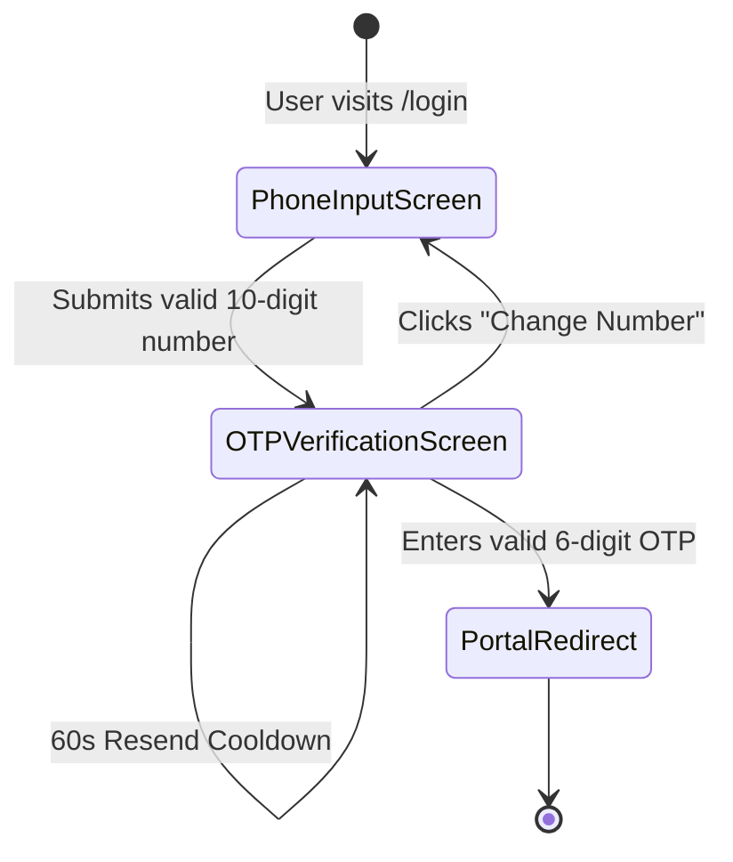

# Frontend & UI/UX Specification

**Project:** Student Management System (Coaching Institute + Mess Fee Management)  
**Technology:** Next.js App Router (JavaScript / JSX) · Tailwind CSS · shadcn/ui · React Hook Form + Zod  
**Document Version:** 2.0 (Phase 0 Aligned)  

---

## 1. Design System Tokens & Guidelines

* **Component Standard:** Built with accessible Radix UI primitives via **shadcn/ui**.
* **Language Convention:** Standard `.js` and `.jsx` (no TypeScript for application code).
* **Color Palette:**
  * **Brand Primary:** Modern slate/indigo (`#4F46E5`, hover `#4338CA`).
  * **Neutral Surface:** Neutral card backgrounds (`bg-white` and `bg-slate-50`, dark: `bg-slate-950`).
  * **Status Accents:**
    * `PRESENT` / `PAID` / `PASS`: Emerald (`bg-emerald-50 text-emerald-700 border-emerald-200`)
    * `ABSENT` / `UNPAID` / `FAIL`: Rose (`bg-rose-50 text-rose-700 border-rose-200`)
    * `LATE` / `PARTIALLY_PAID`: Amber (`bg-amber-50 text-amber-700 border-amber-200`)
    * `LEAVE` / `OVERDUE`: Purple/Orange (`bg-purple-50 text-purple-700 border-purple-200`)
* **Currency Formatting Invariant:**
  All monetary data arrives as integer paise (`amountPaise`). UI views MUST format using standard currency helper:
  ```javascript
  // src/lib/money/format.js
  export function formatINR(amountPaise) {
    if (typeof amountPaise !== 'number' || isNaN(amountPaise)) return '₹0.00';
    return (amountPaise / 100).toLocaleString('en-IN', {
      style: 'currency',
      currency: 'INR',
      minimumFractionDigits: 2,
    });
  }
  ```

---

## 2. Authentication & WhatsApp OTP Screen Flow

The authentication interface handles passwordless login across all roles via registered mobile numbers.



### 2.1 Screen 1: Phone Number Input (`/login`)
* **Elements:**
  * Institute Logo and Welcome Title ("Sign in to your Portal").
  * Input field with fixed country code prefix `+91` and 10-digit mobile number input.
  * Primary Button: "Send WhatsApp OTP".
  * Anti-Enumeration Feedback: "If your number is registered in institute records, an OTP will be dispatched to your WhatsApp."

### 2.2 Screen 2: 6-Digit OTP Verification (`/verify-otp`)
* **Elements:**
  * Display masked phone number (e.g. `+91 ••••• ••210`).
  * 6 individual digit input boxes with auto-tabbing, backspace support, and paste detection.
  * Cooldown Timer: "Resend code in 0:54". Button remains disabled until cooldown hits zero.
  * Link: "Use different phone number".

---

## 3. Role-Based Navigation & Page Layouts

```mermaid
flowchart TD
    Root["/ (Auth Verification Middleware)"]
    Root -->|Role = ADMIN| AdminPortal["/admin/* (Admin Layout)"]
    Root -->|Role = TEACHER| TeacherPortal["/teacher/* (Teacher Layout)"]
    Root -->|Role = STUDENT| StudentPortal["/student/* (Student Layout)"]
    Root -->|Role = PARENT| ParentPortal["/parent/* (Parent Layout)"]

    subgraph AdminPortalRoutes["Admin Routes"]
        AdminPortal --> A1["/admin/dashboard"]
        AdminPortal --> A2["/admin/students (Admissions & Roster)"]
        AdminPortal --> A3["/admin/teachers (Staff & Assignments)"]
        AdminPortal --> A4["/admin/academics (Sessions, Classes, Subjects)"]
        AdminPortal --> A5["/admin/attendance (Daily & Period Registers)"]
        AdminPortal --> A6["/admin/examinations (Schedules & Grade Sheets)"]
        AdminPortal --> A7["/admin/timetable (Slot Grid & Conflict Warnings)"]
        AdminPortal --> A8["/admin/finance (Fee Plans, Invoices, Payments)"]
        AdminPortal --> A9["/admin/reports & /admin/audit-logs"]
    end

    subgraph TeacherPortalRoutes["Teacher Routes"]
        TeacherPortal --> T1["/teacher/dashboard"]
        TeacherPortal --> T2["/teacher/my-classes"]
        TeacherPortal --> T3["/teacher/attendance (Mark Registers)"]
        TeacherPortal --> T4["/teacher/performance (Daily Scores & Remarks)"]
        TeacherPortal --> T5["/teacher/examinations (Enter Subject Marks)"]
        TeacherPortal --> T6["/teacher/timetable (Personal Schedule)"]
        TeacherPortal --> T7["/teacher/assigned-fees (Assigned Class Fees)"]
    end

    subgraph StudentPortalRoutes["Student Routes"]
        StudentPortal --> S1["/student/dashboard"]
        StudentPortal --> S2["/student/profile"]
        StudentPortal --> S3["/student/attendance (Monthly Calendar)"]
        StudentPortal --> S4["/student/performance (Test Scores & Remarks)"]
        StudentPortal --> S5["/student/results (Exam Report Cards)"]
        StudentPortal --> S6["/student/timetable (Class Schedule)"]
    end

    subgraph ParentPortalRoutes["Parent Routes"]
        ParentPortal --> P0["[Global Child Switcher Dropdown]"]
        P0 --> P1["/parent/dashboard"]
        P0 --> P2["/parent/profile"]
        P0 --> P3["/parent/attendance"]
        P0 --> P4["/parent/performance"]
        P0 --> P5["/parent/exam-results"]
        P0 --> P6["/parent/timetable"]
        P0 --> P7["/parent/fees (Invoices & Receipts - View Only)"]
    end
```



---

## 4. Key Interactive Components

### 4.1 Parent Child Switcher Component (`src/components/layout/child-switcher.jsx`)
* Rendered in the top navigation bar of all `/parent/*` pages.
* Queries verified children from `parent_students`.
* Selecting a child updates the active child state without reloading, fetching the corresponding enrollment for the selected academic session.

### 4.2 Rapid Attendance Entry Sheet (`src/components/attendance/daily-register.jsx`)
Optimized for mobile/tablet speed during morning roll call:
* Table displays Student Roll Number, Student Photo thumbnail, Full Name.
* Four status buttons per row: `P` (Present), `A` (Absent), `L` (Late), `Lv` (Leave).
* Global "Mark All Present" button.
* Keyboard hotkeys: `P`, `A`, `L`, `Tab` (move to next row).
* Unsaved change indicator and atomic save button.

### 4.3 Timetable Weekly Grid Matrix (`src/components/timetable/weekly-matrix.jsx`)
* Mon–Sat columns, 1–8 period rows.
* Visual collision badges: highlights if a teacher or room has overlapping slots.
* Color-coded cards by subject code.

### 4.4 Fee Collection & Receipt Generation Dialog (`src/components/finance/payment-modal.jsx`)
* Shows outstanding invoice balance formatted in INR.
* Input: Payment Amount in INR (auto-converted to integer paise for API payload).
* Mode: Cash, UPI QR code, Bank Transfer.
* UPI / Bank Reference text field (required for non-cash methods).
* Instant printable/downloadable receipt trigger upon confirmation.
