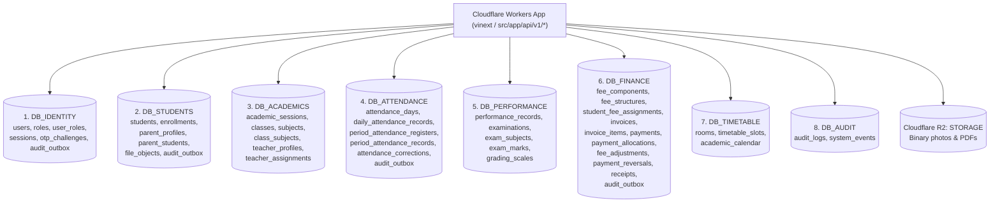
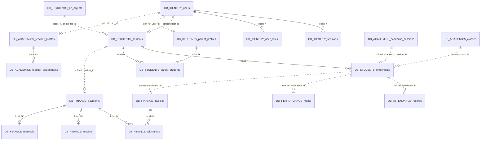

# Phase A — 8-D1 Database Architecture Proposal

**Project:** Student Management System (Coaching Institute + Mess Fee Management)  
**Status:** Phase A Design Proposal (Awaiting Stakeholder / Architect Review — **Not Yet Implemented**)  
**Runtime Stack:** JavaScript / JSX · Next.js App Router (`vinext`) · Cloudflare Workers · 8× Cloudflare D1 (SQLite) · Cloudflare R2 · Native SQL & Wrangler Migrations (Zero ORM)  
**Primary Source of Existing Schema Truth:** [0001_initial_schema.sql](file:///home/atanu/Desktop/student-management/migrations/0001_initial_schema.sql) & [0002_otp_provider_job_id.sql](file:///home/atanu/Desktop/student-management/migrations/0002_otp_provider_job_id.sql)

---

> [!NOTE]
> **Reading Guide (Fact vs. Proposal vs. Open Question):**
> * **Verified Existing Facts** are derived directly from `migrations/0001_initial_schema.sql`, `migrations/0002_otp_provider_job_id.sql`, `seeds/seed.sql`, `wrangler.toml`, `package.json`, `src/`, and `tests/`.
> * **Proposed Phase A Decisions** represent the recommended 8-D1 schema, binding, consistency, and migration design.
> * **Open Architectural Questions** are explicitly isolated in Section 10 for sign-off before Phase A implementation begins.

---

## 1. Final Database Ownership & Boundaries

| # | Binding Name | Database Name | Migration Dir | Domain Ownership | Tables Owned (45 Total) |
| :-: | :--- | :--- | :--- | :--- | :--- |
| 1 | `DB_IDENTITY` | `sms-d1-identity` | `migrations/identity` | Authentication, RBAC roles, WhatsApp OTP challenges, cookie sessions, critical auth outbox | `users`, `roles`, `user_roles`, `sessions`, `otp_challenges`, `audit_outbox` |
| 2 | `DB_STUDENTS` | `sms-d1-students` | `migrations/students` | Student identities, session enrollments, parent profiles & links, R2 file metadata, critical student outbox | `students`, `enrollments`, `parent_profiles`, `parent_students`, `file_objects`, `audit_outbox` |
| 3 | `DB_ACADEMICS` | `sms-d1-academics` | `migrations/academics` | Academic sessions, classes, subjects, curriculum mapping, teachers & scoped assignments | `academic_sessions`, `classes`, `subjects`, `class_subjects`, `teacher_profiles`, `teacher_assignments` |
| 4 | `DB_ATTENDANCE` | `sms-d1-attendance` | `migrations/attendance` | Daily institutional register, period-wise register, post-lock attendance corrections, critical attendance outbox | `attendance_days`, `daily_attendance_records`, `period_attendance_registers`, `period_attendance_records`, `attendance_corrections`, `audit_outbox` |
| 5 | `DB_PERFORMANCE` | `sms-d1-performance` | `migrations/performance` | Daily class tests/homework/remarks, exams, exam subjects, marks, grading scales | `performance_records`, `examinations`, `exam_subjects`, `exam_marks`, `grading_scales` |
| 6 | `DB_FINANCE` | `sms-d1-finance` | `migrations/finance` | Fee heads, class fee structures, overrides, invoices, items, payments, allocations, adjustments, reversals, receipts, critical finance outbox | `fee_components`, `fee_structures`, `student_fee_assignments`, `invoices`, `invoice_items`, `payments`, `payment_allocations`, `fee_adjustments`, `payment_reversals`, `receipts`, `audit_outbox` |
| 7 | `DB_TIMETABLE` | `sms-d1-timetable` | `migrations/timetable` | Classrooms, weekly timetable slots, academic/holiday calendar | `rooms`, `timetable_slots`, `academic_calendar` |
| 8 | `DB_AUDIT` | `sms-d1-audit` | `migrations/audit` | Immutable entity mutation audit trail and operational system/reconciliation events | `audit_logs`, `system_events` |

### Architecture Boundary Diagram

### Cross-Domain Logical Relationship Map

---

## 2. Global Schema & Coding Conventions

All 8 databases MUST adhere uniformly to these SQLite/Workers conventions:

1. **Primary Keys:** Application-generated RFC 4122 UUID v4 `TEXT PRIMARY KEY` (never `INTEGER PRIMARY KEY AUTOINCREMENT`, avoiding sequence coupling).
2. **Timestamps:** UTC ISO-8601 `TEXT` strings (`YYYY-MM-DDTHH:MM:SS.sssZ`), generated in Workers JS (`nowIso()`).
3. **Calendar Dates & Times:** Calendar dates as `TEXT` `YYYY-MM-DD`; timetable times as `TEXT` `HH:MM` (24-hour).
4. **Booleans:** `INTEGER NOT NULL DEFAULT 0|1 CHECK (<col> IN (0, 1))`. Repositories MUST bind `1` or `0`, never JS `true`/`false`.
5. **Money:** Integer paise (`*_paise INTEGER NOT NULL`, `1 INR = 100 paise`). Floating-point arithmetic or `REAL` columns for monetary values are strictly forbidden.
6. **Foreign Keys:** Always enable `PRAGMA foreign_keys = ON;` in migrations and test setups for **intra-database** FKs. Cross-D1 references are `TEXT` UUID columns without `REFERENCES`, indexed for lookup and validated in application services.
7. **Naming:** Snake_case `tables` and `columns`; indexes named `idx_<table>_<purpose>`.
8. **Historical Data Retention:** Never `ON DELETE CASCADE` academic, attendance, exam, or financial history. Use `ON DELETE RESTRICT` locally and deactivation/lifecycle statuses (`is_active = 0`, `lifecycle_status = 'LEFT'|'ALUMNI'`, `enrollment_status`) instead of hard deletes.

---

## 3. Detailed Column-Level Schema Inventory (All 8 Databases)

### 3.1 `DB_IDENTITY` (`sms-d1-identity`)

| Table | Column | Type & Constraints | Notes / Origin |
| :--- | :--- | :--- | :--- |
| **`users`** | `id` | `TEXT PRIMARY KEY` | UUID v4 |
| | `phone_normalized` | `TEXT NOT NULL UNIQUE CHECK (phone_normalized LIKE '+%')` | E.164 (`+91...`) |
| | `email` | `TEXT CHECK (email IS NULL OR length(trim(email)) > 0)` | Optional; partial unique index |
| | `is_active` | `INTEGER NOT NULL DEFAULT 1 CHECK (is_active IN (0, 1))` | Deactivation flag |
| | `created_at` | `TEXT NOT NULL` | UTC ISO-8601 |
| | `updated_at` | `TEXT NOT NULL` | UTC ISO-8601 |
| **`roles`** | `id` | `TEXT PRIMARY KEY` | UUID v4 |
| | `name` | `TEXT NOT NULL UNIQUE CHECK (name IN ('SUPER_ADMIN', 'COACHING_ADMIN', 'TEACHER', 'STUDENT', 'PARENT'))` | Canonical 5 roles |
| | `description` | `TEXT` | Nullable |
| **`user_roles`** | `id` | `TEXT PRIMARY KEY` | UUID v4 |
| | `user_id` | `TEXT NOT NULL REFERENCES users(id) ON DELETE CASCADE` | Local FK |
| | `role_id` | `TEXT NOT NULL REFERENCES roles(id) ON DELETE RESTRICT` | Local FK |
| | `created_at` | `TEXT NOT NULL DEFAULT (strftime('%Y-%m-%dT%H:%M:%fZ', 'now'))` | `UNIQUE (user_id, role_id)` |
| **`otp_challenges`** | `id` | `TEXT PRIMARY KEY` | UUID v4 |
| | `phone_normalized` | `TEXT NOT NULL CHECK (phone_normalized LIKE '+%')` | E.164 |
| | `otp_hash` | `TEXT NOT NULL` | HMAC-SHA-256 hash |
| | `expires_at` | `TEXT NOT NULL` | +5 min |
| | `attempts` | `INTEGER NOT NULL DEFAULT 0 CHECK (attempts >= 0)` | Max 3 |
| | `consumed_at` | `TEXT` | Single-use guard |
| | `delivery_status` | `TEXT NOT NULL DEFAULT 'PENDING' CHECK (delivery_status IN ('PENDING', 'DELIVERED', 'FAILED'))` | WhatsApp dispatch status |
| | `request_ip` | `TEXT` | Rate-limit key |
| | `provider_job_id` | `TEXT` | From migration `0002` (Ogensync `jobId`) |
| | `created_at` | `TEXT NOT NULL` | UTC ISO-8601 |
| **`sessions`** | `id` | `TEXT PRIMARY KEY` | UUID v4 |
| | `user_id` | `TEXT NOT NULL REFERENCES users(id) ON DELETE CASCADE` | Local FK |
| | `token_hash` | `TEXT NOT NULL UNIQUE` | SHA-256 of cookie token |
| | `expires_at` | `TEXT NOT NULL` | 7-day expiry |
| | `revoked_at` | `TEXT` | Nullable |
| | `user_agent` | `TEXT` | Request metadata |
| | `ip_address` | `TEXT` | Request metadata |
| | `created_at` | `TEXT NOT NULL` | UTC ISO-8601 |
| **`audit_outbox`** *(NEW)* | `id` | `TEXT PRIMARY KEY` | Stable event ID (matches `DB_AUDIT.audit_logs.id`) |
| | `actor_user_id` | `TEXT` | Soft ref -> `users.id` |
| | `action` | `TEXT NOT NULL CHECK (action IN ('CREATE', 'UPDATE', 'DELETE', 'CORRECTION', 'ALLOCATION', 'REVERSAL', 'REVOKE', 'UNLINK'))` | Canonical audit action |
| | `entity_type` | `TEXT NOT NULL` | e.g. `USER`, `SESSION`, `ROLE` |
| | `entity_id` | `TEXT NOT NULL` | Target UUID |
| | `old_values` | `TEXT` | Redacted JSON |
| | `new_values` | `TEXT` | Redacted JSON |
| | `ip_address` | `TEXT` | Client IP |
| | `request_id` | `TEXT` | Correlation ID |
| | `status` | `TEXT NOT NULL DEFAULT 'PENDING' CHECK (status IN ('PENDING', 'DELIVERED', 'FAILED'))` | Delivery state |
| | `attempts` | `INTEGER NOT NULL DEFAULT 0 CHECK (attempts >= 0)` | Retry counter |
| | `last_error` | `TEXT` | Last delivery error |
| | `created_at` | `TEXT NOT NULL` | UTC ISO-8601 |
| | `delivered_at` | `TEXT` | Nullable delivery timestamp |

**Indexes (`DB_IDENTITY`):**
* `idx_users_email_unique ON users(email) WHERE email IS NOT NULL` (`UNIQUE`)
* `idx_users_active ON users(is_active, created_at)`
* `idx_user_roles_user ON user_roles(user_id)` & `idx_user_roles_role ON user_roles(role_id)`
* `idx_otp_challenges_phone_created ON otp_challenges(phone_normalized, created_at)`
* `idx_otp_challenges_ip_created ON otp_challenges(request_ip, created_at) WHERE request_ip IS NOT NULL`
* `idx_otp_challenges_provider_job ON otp_challenges(provider_job_id) WHERE provider_job_id IS NOT NULL`
* `idx_sessions_user_active ON sessions(user_id, revoked_at, expires_at)`
* `idx_audit_outbox_pending ON audit_outbox(status, created_at) WHERE status = 'PENDING'`

---

### 3.2 `DB_STUDENTS` (`sms-d1-students`)

| Table | Column | Type & Constraints | Notes / Cross-D1 Ref |
| :--- | :--- | :--- | :--- |
| **`file_objects`** | `id` | `TEXT PRIMARY KEY` | R2 metadata |
| | `r2_object_key` | `TEXT NOT NULL UNIQUE CHECK (r2_object_key NOT LIKE '/%' AND instr(r2_object_key, '..') = 0)` | Server-generated R2 key |
| | `category` | `TEXT NOT NULL CHECK (category IN ('STUDENT_PHOTO', 'TEACHER_PHOTO', 'DOCUMENT'))` | Asset category |
| | `mime_type` | `TEXT NOT NULL CHECK (mime_type IN ('image/jpeg', 'image/png', 'image/webp', 'application/pdf'))` | Magic-byte verified |
| | `size_bytes` | `INTEGER NOT NULL CHECK (size_bytes > 0 AND size_bytes <= 5242880)` | Max 5 MB |
| | `owner_entity_type` | `TEXT CHECK (owner_entity_type IS NULL OR owner_entity_type IN ('STUDENT', 'TEACHER', 'PARENT', 'INVOICE', 'PAYMENT', 'GENERAL'))` | Polymorphic owner |
| | `owner_entity_id` | `TEXT` | Soft ref; `CHECK ((owner_entity_type IS NULL AND owner_entity_id IS NULL) OR (owner_entity_type IS NOT NULL AND owner_entity_id IS NOT NULL))` |
| | `uploaded_by_user_id` | `TEXT` | **Cross-D1 soft ref -> `DB_IDENTITY.users.id`** |
| | `created_at` | `TEXT NOT NULL` | UTC ISO-8601 |
| **`students`** | `id` | `TEXT PRIMARY KEY` | Permanent student ID |
| | `user_id` | `TEXT UNIQUE` | **Cross-D1 soft ref -> `DB_IDENTITY.users.id`** (nullable) |
| | `admission_number` | `TEXT NOT NULL UNIQUE` | e.g. `ADM-2026-0001` |
| | `full_name` | `TEXT NOT NULL` | Required |
| | `date_of_birth` | `TEXT NOT NULL` | `YYYY-MM-DD` |
| | `gender` | `TEXT NOT NULL CHECK (gender IN ('Male', 'Female', 'Other'))` | Required |
| | `blood_group` | `TEXT` | Optional |
| | `photo_file_id` | `TEXT REFERENCES file_objects(id) ON DELETE SET NULL` | **Local FK** |
| | `contact_phone` | `TEXT` | Optional |
| | `residential_address` | `TEXT` | Optional |
| | `emergency_contact_name` | `TEXT NOT NULL` | Required |
| | `emergency_contact_phone` | `TEXT NOT NULL` | Required |
| | `lifecycle_status` | `TEXT NOT NULL DEFAULT 'ACTIVE' CHECK (lifecycle_status IN ('ACTIVE', 'INACTIVE', 'ALUMNI', 'LEFT'))` | Lifecycle |
| | `admission_date` | `TEXT NOT NULL` | `YYYY-MM-DD` |
| | `created_at` | `TEXT NOT NULL` | UTC ISO-8601 |
| | `updated_at` | `TEXT NOT NULL DEFAULT (strftime('%Y-%m-%dT%H:%M:%fZ', 'now'))` | UTC ISO-8601 |
| **`parent_profiles`** | `id` | `TEXT PRIMARY KEY` | Guardian ID |
| | `user_id` | `TEXT NOT NULL UNIQUE` | **Cross-D1 soft ref -> `DB_IDENTITY.users.id`** |
| | `full_name` | `TEXT NOT NULL` | Required |
| | `phone_normalized` | `TEXT NOT NULL CHECK (phone_normalized LIKE '+%')` | E.164 |
| | `email` | `TEXT` | Optional |
| | `relationship_type` | `TEXT NOT NULL CHECK (relationship_type IN ('Father', 'Mother', 'Guardian'))` | Required |
| | `created_at` | `TEXT NOT NULL` | UTC ISO-8601 |
| **`parent_students`** | `id` | `TEXT PRIMARY KEY` | M:N link |
| | `parent_profile_id` | `TEXT NOT NULL REFERENCES parent_profiles(id) ON DELETE RESTRICT` | **Local FK** |
| | `student_id` | `TEXT NOT NULL REFERENCES students(id) ON DELETE RESTRICT` | **Local FK** |
| | `is_primary` | `INTEGER NOT NULL DEFAULT 1 CHECK (is_primary IN (0, 1))` | Primary flag |
| | `verification_status` | `TEXT NOT NULL DEFAULT 'VERIFIED' CHECK (verification_status IN ('VERIFIED', 'PENDING'))` | Isolation guard |
| | `created_at` | `TEXT NOT NULL DEFAULT (strftime('%Y-%m-%dT%H:%M:%fZ', 'now'))` | `UNIQUE (parent_profile_id, student_id)` |
| **`enrollments`** | `id` | `TEXT PRIMARY KEY` | Session enrollment ID |
| | `student_id` | `TEXT NOT NULL REFERENCES students(id) ON DELETE RESTRICT` | **Local FK** |
| | `academic_session_id` | `TEXT NOT NULL` | **Cross-D1 soft ref -> `DB_ACADEMICS.academic_sessions.id`** |
| | `class_id` | `TEXT NOT NULL` | **Cross-D1 soft ref -> `DB_ACADEMICS.classes.id`** |
| | `roll_number` | `TEXT` | Optional |
| | `enrollment_status` | `TEXT NOT NULL DEFAULT 'ACTIVE' CHECK (enrollment_status IN ('ACTIVE', 'PROMOTED', 'REPEATED', 'TRANSFERRED', 'LEFT'))` | History status |
| | `start_date` | `TEXT NOT NULL` | `YYYY-MM-DD` |
| | `end_date` | `TEXT` | Nullable |
| | `created_at` | `TEXT NOT NULL DEFAULT (strftime('%Y-%m-%dT%H:%M:%fZ', 'now'))` | `UNIQUE (student_id, academic_session_id)` |
| **`audit_outbox`** *(NEW)* | *(Same schema as `DB_IDENTITY.audit_outbox`)* | | Critical student/parent-unlink outbox |

**Indexes (`DB_STUDENTS`):**
* `idx_file_objects_category_created ON file_objects(category, created_at)`
* `idx_file_objects_owner ON file_objects(owner_entity_type, owner_entity_id) WHERE owner_entity_type IS NOT NULL`
* `idx_file_objects_uploader ON file_objects(uploaded_by_user_id)`
* `idx_students_lifecycle_created ON students(lifecycle_status, created_at)` & `idx_students_full_name ON students(full_name)`
* `idx_parent_profiles_phone ON parent_profiles(phone_normalized)`
* `idx_parent_students_parent_verified ON parent_students(parent_profile_id, verification_status)` & `idx_parent_students_student ON parent_students(student_id)`
* `idx_enrollments_session_class_status ON enrollments(academic_session_id, class_id, enrollment_status, roll_number)` & `idx_enrollments_class_session ON enrollments(class_id, academic_session_id)`
* `idx_audit_outbox_pending ON audit_outbox(status, created_at) WHERE status = 'PENDING'`

---

### 3.3 `DB_ACADEMICS` (`sms-d1-academics`)

| Table | Column | Type & Constraints | Notes / Cross-D1 Ref |
| :--- | :--- | :--- | :--- |
| **`academic_sessions`** | `id` | `TEXT PRIMARY KEY` | Session ID |
| | `name` | `TEXT NOT NULL UNIQUE` | e.g. `2026-2027` |
| | `start_date` | `TEXT NOT NULL` | `YYYY-MM-DD` |
| | `end_date` | `TEXT NOT NULL` | `CHECK (end_date >= start_date)` |
| | `is_active` | `INTEGER NOT NULL DEFAULT 0 CHECK (is_active IN (0, 1))` | Single active partial unique index |
| | `created_at` | `TEXT NOT NULL` | UTC ISO-8601 |
| **`classes`** | `id` | `TEXT PRIMARY KEY` | Class ID |
| | `name` | `TEXT NOT NULL` | e.g. `Class 10` |
| | `grade_level` | `INTEGER NOT NULL CHECK (grade_level >= 1)` | Numeric grade |
| | `section` | `TEXT` | Nullable; `UNIQUE (name, section)` |
| **`subjects`** | `id` | `TEXT PRIMARY KEY` | Subject ID |
| | `name` | `TEXT NOT NULL` | Required |
| | `code` | `TEXT NOT NULL UNIQUE` | e.g. `MATH-10` |
| | `created_at` | `TEXT NOT NULL` | UTC ISO-8601 |
| **`class_subjects`** | `id` | `TEXT PRIMARY KEY` | Curriculum link |
| | `academic_session_id` | `TEXT NOT NULL REFERENCES academic_sessions(id) ON DELETE RESTRICT` | **Local FK** |
| | `class_id` | `TEXT NOT NULL REFERENCES classes(id) ON DELETE RESTRICT` | **Local FK** |
| | `subject_id` | `TEXT NOT NULL REFERENCES subjects(id) ON DELETE RESTRICT` | **Local FK**; `UNIQUE (academic_session_id, class_id, subject_id)` |
| **`teacher_profiles`** | `id` | `TEXT PRIMARY KEY` | Teacher ID |
| | `user_id` | `TEXT NOT NULL UNIQUE` | **Cross-D1 soft ref -> `DB_IDENTITY.users.id`** |
| | `employee_code` | `TEXT NOT NULL UNIQUE` | e.g. `TCH-001` |
| | `full_name` | `TEXT NOT NULL` | Required |
| | `qualification` | `TEXT` | Optional |
| | `specialization` | `TEXT` | Optional |
| | `joining_date` | `TEXT NOT NULL` | `YYYY-MM-DD` |
| | `employment_status` | `TEXT NOT NULL DEFAULT 'ACTIVE' CHECK (employment_status IN ('ACTIVE', 'INACTIVE', 'LEFT'))` | Employment state |
| | `photo_file_id` | `TEXT` | **Cross-D1 soft ref -> `DB_STUDENTS.file_objects.id`** |
| | `created_at` | `TEXT NOT NULL` | UTC ISO-8601 |
| **`teacher_assignments`** | `id` | `TEXT PRIMARY KEY` | Assignment ID |
| | `teacher_profile_id` | `TEXT NOT NULL REFERENCES teacher_profiles(id) ON DELETE RESTRICT` | **Local FK** |
| | `academic_session_id` | `TEXT NOT NULL REFERENCES academic_sessions(id) ON DELETE RESTRICT` | **Local FK** |
| | `class_id` | `TEXT NOT NULL REFERENCES classes(id) ON DELETE RESTRICT` | **Local FK** |
| | `subject_id` | `TEXT NOT NULL REFERENCES subjects(id) ON DELETE RESTRICT` | **Local FK** |
| | `responsibility_category` | `TEXT NOT NULL CHECK (responsibility_category IN ('REGULAR_TEACHER', 'CLASS_TEACHER'))` | `UNIQUE (teacher_profile_id, academic_session_id, class_id, subject_id, responsibility_category)` |
| | `created_at` | `TEXT NOT NULL DEFAULT (strftime('%Y-%m-%dT%H:%M:%fZ', 'now'))` | UTC ISO-8601 |

**Indexes (`DB_ACADEMICS`):**
* `idx_academic_sessions_single_active ON academic_sessions(is_active) WHERE is_active = 1` (`UNIQUE`)
* `idx_classes_name_no_section ON classes(name) WHERE section IS NULL` (`UNIQUE`) & `idx_classes_grade_name ON classes(grade_level, name)`
* `idx_class_subjects_session_class ON class_subjects(academic_session_id, class_id)`
* `idx_teacher_profiles_status ON teacher_profiles(employment_status)`
* `idx_teacher_assignments_teacher_session ON teacher_assignments(teacher_profile_id, academic_session_id, responsibility_category)`
* `idx_teacher_assignments_session_class_subject ON teacher_assignments(academic_session_id, class_id, subject_id)`

---

### 3.4 `DB_ATTENDANCE` (`sms-d1-attendance`)

| Table | Column | Type & Constraints | Notes / Cross-D1 Ref |
| :--- | :--- | :--- | :--- |
| **`attendance_days`** | `id` | `TEXT PRIMARY KEY` | Daily register header |
| | `academic_session_id` | `TEXT NOT NULL` | **Cross-D1 soft ref -> `DB_ACADEMICS.academic_sessions.id`** |
| | `class_id` | `TEXT NOT NULL` | **Cross-D1 soft ref -> `DB_ACADEMICS.classes.id`** |
| | `attendance_date` | `TEXT NOT NULL` | `YYYY-MM-DD`; `UNIQUE (academic_session_id, class_id, attendance_date)` |
| | `marked_by_teacher_id` | `TEXT` | **Cross-D1 soft ref -> `DB_ACADEMICS.teacher_profiles.id`** |
| | `is_locked` | `INTEGER NOT NULL DEFAULT 0 CHECK (is_locked IN (0, 1))` | 24h lock flag |
| | `created_at` | `TEXT NOT NULL` | UTC ISO-8601 |
| **`daily_attendance_records`** | `id` | `TEXT PRIMARY KEY` | Daily mark |
| | `attendance_day_id` | `TEXT NOT NULL REFERENCES attendance_days(id) ON DELETE RESTRICT` | **Local FK** |
| | `enrollment_id` | `TEXT NOT NULL` | **Cross-D1 soft ref -> `DB_STUDENTS.enrollments.id`** |
| | `status` | `TEXT NOT NULL CHECK (status IN ('PRESENT', 'ABSENT', 'LATE', 'LEAVE'))` | Status enum |
| | `remarks` | `TEXT` | Optional |
| | `created_at` | `TEXT NOT NULL` | `UNIQUE (attendance_day_id, enrollment_id)` |
| **`period_attendance_registers`** | `id` | `TEXT PRIMARY KEY` | Period register header |
| | `academic_session_id` | `TEXT NOT NULL` | **Cross-D1 soft ref -> `DB_ACADEMICS.academic_sessions.id`** |
| | `class_id` | `TEXT NOT NULL` | **Cross-D1 soft ref -> `DB_ACADEMICS.classes.id`** |
| | `subject_id` | `TEXT NOT NULL` | **Cross-D1 soft ref -> `DB_ACADEMICS.subjects.id`** |
| | `attendance_date` | `TEXT NOT NULL` | `YYYY-MM-DD` |
| | `period_number` | `INTEGER NOT NULL CHECK (period_number >= 1)` | `UNIQUE (academic_session_id, class_id, subject_id, attendance_date, period_number)` |
| | `marked_by_teacher_id` | `TEXT` | **Cross-D1 soft ref -> `DB_ACADEMICS.teacher_profiles.id`** |
| | `is_locked` | `INTEGER NOT NULL DEFAULT 0 CHECK (is_locked IN (0, 1))` | 24h lock flag |
| | `created_at` | `TEXT NOT NULL` | UTC ISO-8601 |
| **`period_attendance_records`** | `id` | `TEXT PRIMARY KEY` | Period mark |
| | `register_id` | `TEXT NOT NULL REFERENCES period_attendance_registers(id) ON DELETE RESTRICT` | **Local FK** |
| | `enrollment_id` | `TEXT NOT NULL` | **Cross-D1 soft ref -> `DB_STUDENTS.enrollments.id`** |
| | `status` | `TEXT NOT NULL CHECK (status IN ('PRESENT', 'ABSENT', 'LATE', 'LEAVE'))` | Status enum |
| | `remarks` | `TEXT` | Optional |
| | `created_at` | `TEXT NOT NULL DEFAULT (strftime('%Y-%m-%dT%H:%M:%fZ', 'now'))` | `UNIQUE (register_id, enrollment_id)` |
| **`attendance_corrections`** *(NEW)* | `id` | `TEXT PRIMARY KEY` | Post-lock / override log |
| | `register_type` | `TEXT NOT NULL CHECK (register_type IN ('DAILY', 'PERIOD'))` | Register kind |
| | `register_id` | `TEXT NOT NULL` | Points to `attendance_days.id` or `period_attendance_registers.id` |
| | `record_id` | `TEXT NOT NULL` | Points to `daily_attendance_records.id` or `period_attendance_records.id` |
| | `enrollment_id` | `TEXT NOT NULL` | **Cross-D1 soft ref -> `DB_STUDENTS.enrollments.id`** |
| | `previous_status` | `TEXT NOT NULL CHECK (previous_status IN ('PRESENT', 'ABSENT', 'LATE', 'LEAVE'))` | Before state |
| | `new_status` | `TEXT NOT NULL CHECK (new_status IN ('PRESENT', 'ABSENT', 'LATE', 'LEAVE') AND new_status != previous_status)` | After state (no-op prevented) |
| | `reason` | `TEXT NOT NULL CHECK (length(trim(reason)) > 0)` | Mandatory justification |
| | `corrected_by_user_id` | `TEXT NOT NULL` | **Cross-D1 soft ref -> `DB_IDENTITY.users.id`** |
| | `request_id` | `TEXT` | Correlation ID |
| | `created_at` | `TEXT NOT NULL` | UTC ISO-8601 |
| **`audit_outbox`** *(NEW)* | *(Same schema as `DB_IDENTITY.audit_outbox`)* | | Critical post-lock correction outbox |

**Indexes (`DB_ATTENDANCE`):**
* `idx_attendance_days_date_session ON attendance_days(attendance_date, academic_session_id)`
* `idx_daily_attendance_enrollment_status ON daily_attendance_records(enrollment_id, status)`
* `idx_period_registers_session_class_date ON period_attendance_registers(academic_session_id, class_id, attendance_date)`
* `idx_period_registers_teacher_date ON period_attendance_registers(marked_by_teacher_id, attendance_date)`
* `idx_period_attendance_enrollment_status ON period_attendance_records(enrollment_id, status)`
* `idx_attendance_corrections_record ON attendance_corrections(register_type, record_id, created_at)` & `idx_attendance_corrections_register ON attendance_corrections(register_type, register_id, created_at)` & `idx_attendance_corrections_enrollment ON attendance_corrections(enrollment_id, created_at)`
* `idx_audit_outbox_pending ON audit_outbox(status, created_at) WHERE status = 'PENDING'`

---

### 3.5 `DB_PERFORMANCE` (`sms-d1-performance`)

| Table | Column | Type & Constraints | Notes / Cross-D1 Ref |
| :--- | :--- | :--- | :--- |
| **`performance_records`** | `id` | `TEXT PRIMARY KEY` | Daily test / homework / remark |
| | `enrollment_id` | `TEXT NOT NULL` | **Cross-D1 soft ref -> `DB_STUDENTS.enrollments.id`** |
| | `teacher_profile_id` | `TEXT NOT NULL` | **Cross-D1 soft ref -> `DB_ACADEMICS.teacher_profiles.id`** |
| | `subject_id` | `TEXT` | **Cross-D1 soft ref -> `DB_ACADEMICS.subjects.id`** (nullable for `GENERAL`) |
| | `evaluation_date` | `TEXT NOT NULL` | `YYYY-MM-DD` |
| | `category` | `TEXT NOT NULL CHECK (category IN ('CLASS_TEST', 'HOMEWORK', 'CLASSWORK', 'GENERAL'))` | Category enum |
| | `marks_obtained` | `REAL CHECK (marks_obtained IS NULL OR marks_obtained >= 0)` | Non-money academic score |
| | `max_marks` | `REAL CHECK (max_marks IS NULL OR max_marks > 0)` | `CHECK (marks_obtained IS NULL OR max_marks IS NULL OR marks_obtained <= max_marks)` |
| | `remarks` | `TEXT NOT NULL` | Inline remark |
| | `created_at` | `TEXT NOT NULL` | UTC ISO-8601 |
| **`examinations`** | `id` | `TEXT PRIMARY KEY` | Exam header |
| | `academic_session_id` | `TEXT NOT NULL` | **Cross-D1 soft ref -> `DB_ACADEMICS.academic_sessions.id`** |
| | `name` | `TEXT NOT NULL` | e.g. `Half-Yearly 2026` |
| | `exam_type` | `TEXT NOT NULL CHECK (exam_type IN ('UNIT_TEST', 'MONTHLY_TEST', 'HALF_YEARLY', 'FINAL'))` | Type enum |
| | `start_date` | `TEXT NOT NULL` | `YYYY-MM-DD` |
| | `end_date` | `TEXT NOT NULL` | `CHECK (end_date >= start_date)` |
| | `is_published` | `INTEGER NOT NULL DEFAULT 0 CHECK (is_published IN (0, 1))` | Publication guard |
| | `created_at` | `TEXT NOT NULL` | UTC ISO-8601 |
| **`exam_subjects`** | `id` | `TEXT PRIMARY KEY` | Exam paper definition |
| | `examination_id` | `TEXT NOT NULL REFERENCES examinations(id) ON DELETE RESTRICT` | **Local FK** |
| | `class_id` | `TEXT NOT NULL` | **Cross-D1 soft ref -> `DB_ACADEMICS.classes.id`** |
| | `subject_id` | `TEXT NOT NULL` | **Cross-D1 soft ref -> `DB_ACADEMICS.subjects.id`**; `UNIQUE (examination_id, class_id, subject_id)` |
| | `exam_date` | `TEXT NOT NULL` | `YYYY-MM-DD` |
| | `max_marks` | `REAL NOT NULL CHECK (max_marks > 0)` | Max marks |
| | `passing_marks` | `REAL NOT NULL CHECK (passing_marks >= 0 AND passing_marks <= max_marks)` | Pass cutoff |
| **`exam_marks`** | `id` | `TEXT PRIMARY KEY` | Student exam score |
| | `exam_subject_id` | `TEXT NOT NULL REFERENCES exam_subjects(id) ON DELETE RESTRICT` | **Local FK** |
| | `enrollment_id` | `TEXT NOT NULL` | **Cross-D1 soft ref -> `DB_STUDENTS.enrollments.id`**; `UNIQUE (exam_subject_id, enrollment_id)` |
| | `marks_obtained` | `REAL CHECK (marks_obtained IS NULL OR marks_obtained >= 0)` | `CHECK (is_absent = 0 OR marks_obtained IS NULL)` *(new consistency guard)* |
| | `is_absent` | `INTEGER NOT NULL DEFAULT 0 CHECK (is_absent IN (0, 1))` | Absent flag |
| | `remarks` | `TEXT` | Optional |
| | `entered_by_teacher_id` | `TEXT` | **Cross-D1 soft ref -> `DB_ACADEMICS.teacher_profiles.id`** |
| | `created_at` | `TEXT NOT NULL` | UTC ISO-8601 |
| **`grading_scales`** | `id` | `TEXT PRIMARY KEY` | Grading bands (`OD-09`) |
| | `academic_session_id` | `TEXT` | **Cross-D1 soft ref -> `DB_ACADEMICS.academic_sessions.id`** (nullable = global default) |
| | `name` | `TEXT NOT NULL` | Scale name |
| | `grade_label` | `TEXT NOT NULL` | e.g. `A+`, `B` |
| | `min_percentage` | `REAL NOT NULL CHECK (min_percentage >= 0 AND min_percentage <= 100)` | Lower bound |
| | `max_percentage` | `REAL NOT NULL CHECK (max_percentage >= 0 AND max_percentage <= 100 AND max_percentage >= min_percentage)` | Upper bound |
| | `grade_point` | `REAL CHECK (grade_point IS NULL OR grade_point >= 0)` | Optional GPA |
| | `is_passing` | `INTEGER NOT NULL DEFAULT 1 CHECK (is_passing IN (0, 1))` | Pass flag |
| | `effective_from` | `TEXT NOT NULL` | `UNIQUE (name, grade_label, effective_from)` |
| | `is_active` | `INTEGER NOT NULL DEFAULT 1 CHECK (is_active IN (0, 1))` | Active flag |
| | `created_at` | `TEXT NOT NULL` | UTC ISO-8601 |

**Indexes (`DB_PERFORMANCE`):**
* `idx_performance_records_enrollment_date ON performance_records(enrollment_id, evaluation_date)`
* `idx_performance_records_teacher_date ON performance_records(teacher_profile_id, evaluation_date)`
* `idx_examinations_session_published ON examinations(academic_session_id, is_published, start_date)`
* `idx_exam_subjects_class_subject ON exam_subjects(class_id, subject_id)`
* `idx_exam_marks_enrollment ON exam_marks(enrollment_id)`
* `idx_grading_scales_session_active ON grading_scales(academic_session_id, is_active, effective_from)`

> **Service-Layer Invariants (`DB_PERFORMANCE`):**
> * `exam_marks.marks_obtained <= exam_subjects.max_marks` cannot be expressed in a single-table SQLite `CHECK` and MUST be validated in the exam-marks service before writing.
> * `grading_scales` percentage bands (`min_percentage`..`max_percentage`) MUST be validated in the grading-scales service for non-overlapping continuity within `(academic_session_id, name, effective_from)`.

---

### 3.6 `DB_FINANCE` (`sms-d1-finance`)

All ledger mutations stay atomic inside `DB_FINANCE.batch([...])`.

| Table | Column | Type & Constraints | Notes / Cross-D1 Ref |
| :--- | :--- | :--- | :--- |
| **`fee_components`** | `id` | `TEXT PRIMARY KEY` | Fee head |
| | `code` | `TEXT NOT NULL UNIQUE CHECK (code IN ('COACHING', 'MESS', 'OTHER'))` | Canonical heads |
| | `name` | `TEXT NOT NULL` | Display name |
| | `description` | `TEXT` | Optional |
| **`fee_structures`** | `id` | `TEXT PRIMARY KEY` | Standard class fee |
| | `academic_session_id` | `TEXT NOT NULL` | **Cross-D1 soft ref -> `DB_ACADEMICS.academic_sessions.id`** |
| | `class_id` | `TEXT NOT NULL` | **Cross-D1 soft ref -> `DB_ACADEMICS.classes.id`** |
| | `fee_component_id` | `TEXT NOT NULL REFERENCES fee_components(id) ON DELETE RESTRICT` | **Local FK**; `UNIQUE (academic_session_id, class_id, fee_component_id)` |
| | `default_amount_paise` | `INTEGER NOT NULL CHECK (default_amount_paise >= 0)` | Integer paise |
| | `effective_from` | `TEXT NOT NULL DEFAULT (strftime('%Y-%m-%d', 'now'))` | `YYYY-MM-DD` |
| **`student_fee_assignments`** | `id` | `TEXT PRIMARY KEY` | Per-enrollment override |
| | `enrollment_id` | `TEXT NOT NULL` | **Cross-D1 soft ref -> `DB_STUDENTS.enrollments.id`** |
| | `fee_component_id` | `TEXT NOT NULL REFERENCES fee_components(id) ON DELETE RESTRICT` | **Local FK**; `UNIQUE (enrollment_id, fee_component_id)` |
| | `custom_amount_paise` | `INTEGER NOT NULL CHECK (custom_amount_paise >= 0)` | Integer paise |
| | `reason` | `TEXT` | Concession reason |
| | `effective_from` | `TEXT NOT NULL` | `YYYY-MM-DD` |
| **`invoices`** | `id` | `TEXT PRIMARY KEY` | Monthly bill snapshot |
| | `invoice_number` | `TEXT NOT NULL UNIQUE` | `INV-YYYYMM-XXXX` |
| | `student_id` | `TEXT NOT NULL` | **Cross-D1 soft ref -> `DB_STUDENTS.students.id`** |
| | `enrollment_id` | `TEXT NOT NULL` | **Cross-D1 soft ref -> `DB_STUDENTS.enrollments.id`** |
| | `billing_month` | `INTEGER NOT NULL CHECK (billing_month BETWEEN 1 AND 12)` | Month 1–12 |
| | `billing_year` | `INTEGER NOT NULL CHECK (billing_year >= 2000 AND billing_year <= 2100)` | Year |
| | `invoice_type` | `TEXT NOT NULL CHECK (invoice_type IN ('COMBINED', 'SEPARATE_COACHING', 'SEPARATE_MESS'))` | `UNIQUE (student_id, billing_month, billing_year, invoice_type)` |
| | `total_amount_paise` | `INTEGER NOT NULL CHECK (total_amount_paise >= 0)` | Snapshot total |
| | `due_date` | `TEXT NOT NULL` | `YYYY-MM-DD` |
| | `status` | `TEXT NOT NULL DEFAULT 'UNPAID' CHECK (status IN ('PAID', 'PARTIALLY_PAID', 'UNPAID'))` | Updated atomically |
| | `created_at` | `TEXT NOT NULL` | UTC ISO-8601 |
| **`invoice_items`** | `id` | `TEXT PRIMARY KEY` | Line item snapshot |
| | `invoice_id` | `TEXT NOT NULL REFERENCES invoices(id) ON DELETE RESTRICT` | **Local FK** |
| | `fee_component_id` | `TEXT NOT NULL REFERENCES fee_components(id) ON DELETE RESTRICT` | **Local FK** |
| | `description` | `TEXT NOT NULL` | Line description |
| | `amount_paise` | `INTEGER NOT NULL CHECK (amount_paise >= 0)` | Integer paise |
| **`payments`** | `id` | `TEXT PRIMARY KEY` | Payment receipted |
| | `student_id` | `TEXT NOT NULL` | **Cross-D1 soft ref -> `DB_STUDENTS.students.id`** |
| | `amount_paid_paise` | `INTEGER NOT NULL CHECK (amount_paid_paise > 0)` | Strictly positive |
| | `payment_method` | `TEXT NOT NULL CHECK (payment_method IN ('CASH', 'UPI', 'BANK_TRANSFER'))` | Method |
| | `transaction_reference` | `TEXT` | UTR / UPI ref |
| | `idempotency_key` | `TEXT UNIQUE` | *(NEW)* Prevents duplicate submission |
| | `status` | `TEXT NOT NULL DEFAULT 'POSTED' CHECK (status IN ('POSTED', 'REVERSED'))` | *(NEW)* Supports reversals cleanly |
| | `payment_date` | `TEXT NOT NULL` | `YYYY-MM-DD` |
| | `notes` | `TEXT` | Optional |
| | `recorded_by_user_id` | `TEXT` | **Cross-D1 soft ref -> `DB_IDENTITY.users.id`** |
| | `created_at` | `TEXT NOT NULL` | UTC ISO-8601 |
| **`payment_allocations`** | `id` | `TEXT PRIMARY KEY` | Payment -> Invoice mapping |
| | `payment_id` | `TEXT NOT NULL REFERENCES payments(id) ON DELETE RESTRICT` | **Local FK** |
| | `invoice_id` | `TEXT NOT NULL REFERENCES invoices(id) ON DELETE RESTRICT` | **Local FK**; `UNIQUE (payment_id, invoice_id)` |
| | `allocated_amount_paise` | `INTEGER NOT NULL CHECK (allocated_amount_paise > 0)` | Integer paise |
| | `created_at` | `TEXT NOT NULL` | UTC ISO-8601 |
| **`fee_adjustments`** *(NEW)* | `id` | `TEXT PRIMARY KEY` | Waivers / corrections / fines (`OD-10`) |
| | `student_id` | `TEXT NOT NULL` | **Cross-D1 soft ref -> `DB_STUDENTS.students.id`** |
| | `enrollment_id` | `TEXT NOT NULL` | **Cross-D1 soft ref -> `DB_STUDENTS.enrollments.id`** |
| | `invoice_id` | `TEXT NOT NULL REFERENCES invoices(id) ON DELETE RESTRICT` | **Local FK** (required in MVP; no invoice-less wallet) |
| | `fee_component_id` | `TEXT REFERENCES fee_components(id) ON DELETE RESTRICT` | **Local FK** (nullable) |
| | `adjustment_type` | `TEXT NOT NULL CHECK (adjustment_type IN ('WAIVER', 'DISCOUNT', 'LATE_FINE', 'CORRECTION'))` | Type enum |
| | `amount_paise` | `INTEGER NOT NULL CHECK ((adjustment_type IN ('WAIVER', 'DISCOUNT') AND amount_paise < 0) OR (adjustment_type = 'LATE_FINE' AND amount_paise > 0) OR (adjustment_type = 'CORRECTION' AND amount_paise != 0))` | Explicit signed delta |
| | `reason` | `TEXT NOT NULL CHECK (length(trim(reason)) > 0)` | Mandatory reason |
| | `idempotency_key` | `TEXT UNIQUE` | Prevents duplicate adjustment submit |
| | `status` | `TEXT NOT NULL DEFAULT 'POSTED' CHECK (status IN ('POSTED', 'VOIDED'))` | Supports safe voiding |
| | `approved_by_user_id` | `TEXT NOT NULL` | **Cross-D1 soft ref -> `DB_IDENTITY.users.id`** |
| | `voided_by_user_id` | `TEXT` | **Cross-D1 soft ref -> `DB_IDENTITY.users.id`** |
| | `voided_at` | `TEXT` | Nullable UTC ISO-8601 |
| | `void_reason` | `TEXT` | `CHECK (status != 'VOIDED' OR (voided_by_user_id IS NOT NULL AND voided_at IS NOT NULL AND length(trim(void_reason)) > 0))` |
| | `request_id` | `TEXT` | Audit correlation ID |
| | `created_at` | `TEXT NOT NULL` | UTC ISO-8601 |
| **`payment_reversals`** *(NEW)* | `id` | `TEXT PRIMARY KEY` | `SUPER_ADMIN` full-reversal record |
| | `payment_id` | `TEXT NOT NULL UNIQUE REFERENCES payments(id) ON DELETE RESTRICT` | **Local FK** (1:1 full reversal only) |
| | `reversed_amount_paise` | `INTEGER NOT NULL CHECK (reversed_amount_paise > 0)` | Must equal `payments.amount_paid_paise` |
| | `reason` | `TEXT NOT NULL CHECK (length(trim(reason)) > 0)` | Mandatory reason |
| | `idempotency_key` | `TEXT UNIQUE` | Prevents duplicate reversal submit |
| | `reversed_by_user_id` | `TEXT NOT NULL` | **Cross-D1 soft ref -> `DB_IDENTITY.users.id`** |
| | `request_id` | `TEXT` | Correlation ID |
| | `created_at` | `TEXT NOT NULL` | UTC ISO-8601 |
| **`receipts`** | `id` | `TEXT PRIMARY KEY` | Printable receipt |
| | `receipt_number` | `TEXT NOT NULL UNIQUE` | `REC-YYYYMM-XXXX` |
| | `payment_id` | `TEXT NOT NULL UNIQUE REFERENCES payments(id) ON DELETE RESTRICT` | **Local FK** |
| | `status` | `TEXT NOT NULL DEFAULT 'ISSUED' CHECK (status IN ('ISSUED', 'VOIDED'))` | Marked `VOIDED` on payment reversal |
| | `voided_at` | `TEXT` | Nullable UTC ISO-8601 |
| | `issued_date` | `TEXT NOT NULL` | `YYYY-MM-DD` |
| | `created_at` | `TEXT NOT NULL` | UTC ISO-8601 |
| **`audit_outbox`** *(NEW)* | *(Same schema as `DB_IDENTITY.audit_outbox`)* | | Critical finance audit outbox |

**Indexes (`DB_FINANCE`):**
* `idx_fee_structures_session_class ON fee_structures(academic_session_id, class_id)`
* `idx_student_fee_assignments_enrollment ON student_fee_assignments(enrollment_id)`
* `idx_invoices_student_status_due ON invoices(student_id, status, due_date)`
* `idx_invoices_enrollment_period ON invoices(enrollment_id, billing_year, billing_month)`
* `idx_invoices_due_date ON invoices(due_date) WHERE status != 'PAID'`
* `idx_invoice_items_invoice ON invoice_items(invoice_id)`
* `idx_payments_student_date ON payments(student_id, payment_date)` & `idx_payments_date ON payments(payment_date)`
* `idx_payment_allocations_invoice ON payment_allocations(invoice_id)`
* `idx_fee_adjustments_student ON fee_adjustments(student_id, created_at)` & `idx_fee_adjustments_invoice ON fee_adjustments(invoice_id, status)`
* `idx_receipts_issued_date ON receipts(issued_date)`
* `idx_audit_outbox_pending ON audit_outbox(status, created_at) WHERE status = 'PENDING'`

---

### 3.7 `DB_TIMETABLE` (`sms-d1-timetable`)

| Table | Column | Type & Constraints | Notes / Cross-D1 Ref |
| :--- | :--- | :--- | :--- |
| **`rooms`** | `id` | `TEXT PRIMARY KEY` | Classroom catalog |
| | `name` | `TEXT NOT NULL UNIQUE` | Display name |
| | `code` | `TEXT NOT NULL UNIQUE` | Short code |
| | `capacity` | `INTEGER CHECK (capacity IS NULL OR capacity > 0)` | Optional |
| | `floor_or_building` | `TEXT` | Optional |
| | `is_active` | `INTEGER NOT NULL DEFAULT 1 CHECK (is_active IN (0, 1))` | Active flag |
| | `created_at` | `TEXT NOT NULL` | UTC ISO-8601 |
| **`timetable_slots`** | `id` | `TEXT PRIMARY KEY` | Weekly schedule slot |
| | `academic_session_id` | `TEXT NOT NULL` | **Cross-D1 soft ref -> `DB_ACADEMICS.academic_sessions.id`** |
| | `class_id` | `TEXT NOT NULL` | **Cross-D1 soft ref -> `DB_ACADEMICS.classes.id`** |
| | `subject_id` | `TEXT NOT NULL` | **Cross-D1 soft ref -> `DB_ACADEMICS.subjects.id`** |
| | `teacher_profile_id` | `TEXT NOT NULL` | **Cross-D1 soft ref -> `DB_ACADEMICS.teacher_profiles.id`** |
| | `room_id` | `TEXT REFERENCES rooms(id) ON DELETE SET NULL` | **Local FK** |
| | `room_name` | `TEXT` | Optional fallback |
| | `day_of_week` | `INTEGER NOT NULL CHECK (day_of_week BETWEEN 1 AND 7)` | 1=Mon .. 7=Sun |
| | `period_number` | `INTEGER NOT NULL CHECK (period_number >= 1)` | Period # |
| | `start_time` | `TEXT NOT NULL` | `HH:MM` |
| | `end_time` | `TEXT NOT NULL` | `CHECK (end_time > start_time)` |
| | `created_at` | `TEXT NOT NULL DEFAULT (strftime('%Y-%m-%dT%H:%M:%fZ', 'now'))` | `UNIQUE (academic_session_id, class_id, day_of_week, period_number)` & `UNIQUE (academic_session_id, teacher_profile_id, day_of_week, period_number)` |
| **`academic_calendar`** *(NEW)* | `id` | `TEXT PRIMARY KEY` | Holidays & calendar (`OD-06`) |
| | `academic_session_id` | `TEXT NOT NULL` | **Cross-D1 soft ref -> `DB_ACADEMICS.academic_sessions.id`** |
| | `calendar_date` | `TEXT NOT NULL` | `YYYY-MM-DD`; `UNIQUE (academic_session_id, calendar_date)` |
| | `day_type` | `TEXT NOT NULL CHECK (day_type IN ('WORKING', 'HOLIDAY', 'EXAM_DAY', 'SPECIAL_EVENT'))` | Calendar type |
| | `title` | `TEXT NOT NULL` | Holiday / event title |
| | `notes` | `TEXT` | Optional |
| | `created_at` | `TEXT NOT NULL` | UTC ISO-8601 |

**Indexes (`DB_TIMETABLE`):**
* `idx_rooms_active ON rooms(is_active, name)`
* `idx_timetable_slots_room_slot ON timetable_slots(academic_session_id, room_id, day_of_week, period_number) WHERE room_id IS NOT NULL`
* `idx_timetable_slots_teacher_day ON timetable_slots(academic_session_id, teacher_profile_id, day_of_week)`
* `idx_academic_calendar_session_type ON academic_calendar(academic_session_id, day_type, calendar_date)`

---

### 3.8 `DB_AUDIT` (`sms-d1-audit`)

| Table | Column | Type & Constraints | Notes / Cross-D1 Ref |
| :--- | :--- | :--- | :--- |
| **`audit_logs`** | `id` | `TEXT PRIMARY KEY` | Immutable entity trail (matches `audit_outbox.id` for `INSERT OR IGNORE` idempotency) |
| | `actor_user_id` | `TEXT` | **Cross-D1 soft ref -> `DB_IDENTITY.users.id`** |
| | `action` | `TEXT NOT NULL CHECK (action IN ('CREATE', 'UPDATE', 'DELETE', 'CORRECTION', 'ALLOCATION', 'REVERSAL', 'REVOKE', 'UNLINK'))` | Action enum |
| | `entity_type` | `TEXT NOT NULL CHECK (length(trim(entity_type)) > 0)` | e.g. `PAYMENT`, `USER` |
| | `entity_id` | `TEXT NOT NULL` | Target UUID |
| | `old_values` | `TEXT` | Redacted JSON |
| | `new_values` | `TEXT` | Redacted JSON |
| | `ip_address` | `TEXT` | Client IP |
| | `request_id` | `TEXT` | Correlation / idempotency key |
| | `created_at` | `TEXT NOT NULL` | UTC ISO-8601 |
| **`system_events`** *(NEW)* | `id` | `TEXT PRIMARY KEY` | Operational / reconciliation log |
| | `event_type` | `TEXT NOT NULL` | e.g. `AUDIT_WRITE_RETRY_NEEDED`, `COMPENSATION_FAILED`, `OTP_PROVIDER_ERROR` |
| | `severity` | `TEXT NOT NULL CHECK (severity IN ('INFO', 'WARN', 'ERROR', 'CRITICAL'))` | Severity |
| | `source_domain` | `TEXT NOT NULL` | e.g. `FINANCE`, `STUDENTS`, `AUTH` |
| | `entity_type` | `TEXT` | Optional |
| | `entity_id` | `TEXT` | Optional |
| | `request_id` | `TEXT` | Correlation ID |
| | `payload_json` | `TEXT` | Redacted diagnostic payload |
| | `resolved_at` | `TEXT` | Nullable resolution timestamp |
| | `created_at` | `TEXT NOT NULL` | UTC ISO-8601 |

**Indexes (`DB_AUDIT`):**
* `idx_audit_logs_entity_created ON audit_logs(entity_type, entity_id, created_at)`
* `idx_audit_logs_actor_created ON audit_logs(actor_user_id, created_at)`
* `idx_audit_logs_request_id ON audit_logs(request_id) WHERE request_id IS NOT NULL`
* `idx_system_events_unresolved ON system_events(severity, created_at) WHERE resolved_at IS NULL`

---

## 4. Cross-D1 References, Validation Rules & Integrity Strategy

* **No Cross-DB Foreign Keys or SQL Joins:** All 23 cross-DB relationships (e.g., `enrollments.academic_session_id` -> `DB_ACADEMICS`, `daily_attendance_records.enrollment_id` -> `DB_STUDENTS`, `invoices.student_id` -> `DB_STUDENTS`, `audit_logs.actor_user_id` -> `DB_IDENTITY`) are soft UUID references.
* **Service-Layer Read-Before-Write Validation:**
  1. Every cross-DB reference passed by a caller MUST be verified in the owning D1 (`SELECT id ... WHERE id = ?`) before writing into the target D1.
  2. Batch operations (e.g., daily attendance, bulk invoicing) resolve and validate the target `enrollment_id[]` set from `DB_STUDENTS` in one `IN (...)` query (chunked `<= 100` bind params) before constructing the target `DB_ATTENDANCE.batch()` / `DB_FINANCE.batch()`.
  3. RBAC authorization checks (`DB_STUDENTS.parent_students` for Parents, `DB_ACADEMICS.teacher_assignments` for Teachers, `403` Student Fee Wall) MUST run **before** any query against `DB_ATTENDANCE`, `DB_PERFORMANCE`, or `DB_FINANCE`.
* **Cross-D1 Search, Hydration, Pagination & Bounded Query Strategy:**
  1. **Bounded `IN (...)` Hydration:** When hydrating cross-D1 labels (e.g., `student_name` from `DB_STUDENTS` or `class_name` from `DB_ACADEMICS` for `DB_FINANCE` / `DB_ATTENDANCE` rows), deduplicate IDs and chunk `IN (...)` queries to **`<= 100` bind parameters** per D1 statement.
  2. **Search-First Filtering:** When filtering/searching a domain list by an attribute owned by another D1 (e.g., `GET /api/v1/finance/invoices?search=Rahul`), query the owning D1 (`DB_STUDENTS`) first for matching `student_id`s (bounded `LIMIT 100`), then query `DB_FINANCE` with `WHERE student_id IN (...)`.
  3. **Primary-Domain Pagination:** Paginate (`LIMIT`/`OFFSET` or keyset) on the primary domain D1 first, then hydrate cross-D1 display fields in parallel via `Promise.all` to keep Workers latency and subrequest counts minimal.

---

## 5. Finance Atomicity, Consistency, Compensation & Audit Delivery

### Intra-DB Atomicity Preserved in `DB_FINANCE`
* **Monthly Invoice Generation:** Reads active `enrollments` from `DB_STUDENTS`, then writes `invoices` + `invoice_items` + `audit_outbox` in `DB_FINANCE.batch([...])` (chunked `<= 250` statements). `UNIQUE (student_id, billing_month, billing_year, invoice_type)` makes retries idempotent (`409 CONFLICT` or skip).
* **Payment + Allocations + Receipt + Status Update:** All 4 tables plus `audit_outbox` live in `DB_FINANCE`. Executed in **one atomic `DB_FINANCE.batch([...])`**, guarded by `payments.idempotency_key UNIQUE` and service-level sum validation (`SUM(allocated_amount_paise) == amount_paid_paise`, never exceeding outstanding invoice balance).
* **Fee Adjustments (`OD-10`):**
  * **Signed Amount Semantics:** `WAIVER` and `DISCOUNT` are strictly negative (`amount_paise < 0`), `LATE_FINE` is strictly positive (`amount_paise > 0`), and `CORRECTION` is non-zero (`amount_paise != 0`).
  * **Invoice-Scoped Only in MVP:** `fee_adjustments.invoice_id` is `NOT NULL` in MVP; invoice-less adjustments / floating credit wallets are **not permitted in MVP** (`OD-10`).
  * **Immutable Billed Snapshot & Net Payable Formula:** `invoices.total_amount_paise` remains the immutable original billed snapshot. Invoice balances are computed as:
    * `net_payable_paise = invoices.total_amount_paise + COALESCE(SUM(posted_adjustments.amount_paise), 0)`
    * `paid_paise = COALESCE(SUM(posted_allocations.allocated_amount_paise), 0)` *(joining `payments WHERE payments.status = 'POSTED'`)*
    * `outstanding_paise = MAX(0, net_payable_paise - paid_paise)`
  * **Atomic Posting / Voiding:** Posting a `fee_adjustment` (guarded by `idempotency_key UNIQUE`) or voiding one (`status = 'VOIDED'`, `voided_by_user_id`, `voided_at`, `void_reason`) MUST recalculate and update `invoices.status` (`PAID`, `PARTIALLY_PAID`, `UNPAID`) and insert into `audit_outbox` inside **one `DB_FINANCE.batch([...])`**.
* **Payment Reversals (`OD-10`):**
  * **Full Reversals Only (MVP):** Only full payment reversals are supported (`1:1` via `payment_reversals.payment_id UNIQUE`; `reversed_amount_paise == payments.amount_paid_paise`, guarded by `idempotency_key UNIQUE`).
  * **Historical Preservation & Paid-Balance Exclusion:** Never delete `payment_allocations` or `receipts`. All queries computing paid amounts or outstanding balances MUST join `payments` with `AND payments.status = 'POSTED'` so reversed payments are excluded.
  * **Atomic Reversal Transaction:** Executed inside **one `DB_FINANCE.batch([...])`**: (1) `INSERT INTO payment_reversals`, (2) `UPDATE payments SET status = 'REVERSED'`, (3) `UPDATE receipts SET status = 'VOIDED', voided_at = ?`, (4) recalculate and `UPDATE invoices.status` (`PAID` -> `PARTIALLY_PAID`/`UNPAID`) for all allocated invoices, and (5) `INSERT INTO audit_outbox`.
  * **Future Partial-Reversal Migration Path:** If partial reversals are approved post-MVP, a follow-up migration must drop `UNIQUE(payment_id)` on `payment_reversals`, add `'PARTIALLY_REVERSED'` to `payments.status`, and introduce `payment_reversal_allocations` to track per-invoice reversed amounts.

### Cross-DB Saga & Compensation Strategy
* **Student / Parent / Teacher Onboarding:**
  1. Validate read-only refs (`DB_ACADEMICS`).
  2. Upload photo to R2 (`STORAGE.put`), if present.
  3. Create `users` + `user_roles` (+ `audit_outbox`) in `DB_IDENTITY.batch()`.
  4. Write profile + `enrollments` + `file_objects` (+ `audit_outbox`) in `DB_STUDENTS.batch()` (or `file_objects` in `DB_STUDENTS` followed by `teacher_profiles` in `DB_ACADEMICS`).
  5. **Compensation on step 4 failure:** Delete uploaded R2 key (`STORAGE.delete`), delete any orphaned `DB_STUDENTS.file_objects` row (if `DB_ACADEMICS.teacher_profiles` failed after `file_objects` insert), deactivate/remove newly created `DB_IDENTITY` user (`is_active = 0` or delete unreferenced draft user), and record `COMPENSATION_FAILED` in `DB_AUDIT.system_events` (plus structured Workers error log) if cleanup itself fails.
* **Cross-D1 Audit Delivery (`DB_AUDIT` + Lightweight Domain-Local Outbox):**
  * **Event Classification:**
    * *Best-Effort Events:* Routine non-critical mutations/reads (e.g., profile display updates, non-critical `DB_ACADEMICS` / `DB_PERFORMANCE` / `DB_TIMETABLE` edits) write directly to `DB_AUDIT.audit_logs` post-commit; on failure, log a structured JSON warning to Workers logs without failing the request.
    * *Critical Events:* Security mutations (`DB_IDENTITY`: `REVOKE`, role/user changes), guardian/student mutations (`DB_STUDENTS`: `UNLINK`, archival), post-lock overrides (`DB_ATTENDANCE`: `CORRECTION`), and all financial mutations (`DB_FINANCE`: `CREATE` invoice, `ALLOCATION`, `REVERSAL`, `FEE_ADJUSTMENT`) use the domain-local `audit_outbox`.
  * **Atomic Outbox Write & Stable Event ID:** The service generates a deterministic UUID v4 `eventId` and includes `INSERT INTO audit_outbox (id, ...)` in the **same `env.DB_<DOMAIN>.batch([...])`** as the critical business mutation.
  * **Fast-Path Delivery & Idempotency:** Immediately after the domain `batch()` commits, the service attempts `INSERT OR IGNORE INTO DB_AUDIT.audit_logs (id, ...)` using `audit_logs.id = audit_outbox.id`. Because `id` is `PRIMARY KEY`, retries are 100% idempotent even when multiple audit events share one `request_id`. On success, update `audit_outbox.status = 'DELIVERED'` and `delivered_at`.
  * **Failure Behavior When `DB_AUDIT` Is Unavailable:** Never roll back committed domain state (`DB_FINANCE`, `DB_IDENTITY`, `DB_ATTENDANCE`, `DB_STUDENTS`). Leave the outbox row as `status = 'PENDING'`, increment `attempts`, record `last_error`, and emit a structured JSON error to Workers logs (do **not** rely on `DB_AUDIT.system_events` as the sole fallback when `DB_AUDIT` itself is unreachable).
  * **Retry & Reconciliation (Lightweight MVP):** A scheduled Workers Cron Trigger and/or `SUPER_ADMIN` reconciliation endpoint (`POST /api/v1/admin/audit/reconcile`) scans `WHERE status = 'PENDING'` across the 4 `audit_outbox` tables, replays `INSERT OR IGNORE INTO DB_AUDIT.audit_logs`, and marks rows `DELIVERED` (or `FAILED` after max attempts, surfacing an alert).

---

## 6. R2 File Metadata Ownership & Storage Strategy

* Binary files remain in private R2 (`STORAGE`), never inside any D1 database.
* `file_objects` lives in **`DB_STUDENTS`** (alongside `students`, `parent_profiles`, and `enrollments`) so `students.photo_file_id` keeps a real local FK and parent/student photo authorization requires only `DB_STUDENTS`.
* Teacher photos (`TEACHER_PHOTO`) store `file_objects.id` as a soft ref in `DB_ACADEMICS.teacher_profiles.photo_file_id`; download handler checks `DB_ACADEMICS` for `TEACHER` ownership before streaming from R2.
* Upload flow: validate magic bytes + `<= 5 MB` -> `STORAGE.put(key, bytes)` -> `DB_STUDENTS.prepare('INSERT INTO file_objects ...').run()` -> compensating `STORAGE.delete(key)` on D1 failure.

---

## 7. Migration, Seed & Multi-D1 Testing Strategy

* **Migration Directories (8 Independent Tracks):**
  * **Pre-Production Safeguard:** Archiving and resetting is safe **only** in the current pre-production development environment (`wrangler.toml` holds placeholder `database_id` zeros and no `--remote` production D1 has been provisioned). Once remote D1s are created, migrations become strictly immutable.
  * Archive existing single-DB `migrations/0001_initial_schema.sql`, `migrations/0002_otp_provider_job_id.sql`, and `seeds/seed.sql` into `docs/archive/single-d1/`.
  * Create 8 separate folders (`migrations/identity/0001_init.sql` .. `migrations/audit/0001_init.sql`), each registered to its corresponding `[[d1_databases]]` entry (`migrations_dir = "migrations/<domain>"`) in `wrangler.toml`.
  * **Local `.wrangler` State Reset:** Wipe stale single-D1 local Miniflare state (`rm -rf .wrangler/state/v3/d1`) before applying the 8 new local migration tracks.
  * **`package.json` Multi-D1 Scripts:** Update `db:migrate:local`, `db:migrate:prod`, `db:seed:local`, and add `db:reset:local` so scripts iterate across all 8 `sms-d1-*` databases and `seeds/01_*.sql`..`08_*.sql` instead of targeting `sms-coaching-d1`.
* **Seed Strategy:** Split synthetic fixtures into 8 domain seed files (`seeds/01_identity.sql` .. `seeds/08_audit.sql`) referencing deterministic UUIDs (`10000000-...`, `11000000-...`, etc.) so cross-DB soft references align cleanly in local dev and tests.
* **Multi-D1 Testing Strategy:**
  * Keep unit tests (`tests/unit/*`) fast and dependency-free.
  * Update `tests/integration/` (`getPlatformProxy`) to run `wrangler d1 migrations apply <db-name> --local --persist-to <tmp>` + `seeds/*.sql` across all 8 bindings.
  * Test: (a) `PRAGMA foreign_keys = ON` per DB, (b) intra-DB `batch()` rollback (`DB_FINANCE`, `DB_IDENTITY`), (c) cross-DB soft-FK rejection, (d) onboarding saga compensation, and (e) multi-DB RBAC isolation.

---

## 8. Existing Schema Inconsistencies Identified

1. **`docs/DATABASE_SCHEMA.md` vs. `0001_initial_schema.sql` (`ON DELETE` drift):** `DATABASE_SCHEMA.md` lists `ON DELETE CASCADE` on 11 child tables (`parent_profiles`, `parent_students`, `daily_attendance_records`, `period_attendance_records`, `performance_records`, `exam_subjects`, `exam_marks`, `fee_structures`, `student_fee_assignments`, `invoice_items`, `payment_allocations`), whereas `0001_initial_schema.sql` enforces `ON DELETE RESTRICT`. Phase A preserves `ON DELETE RESTRICT`.
2. **Undocumented Columns/Tables in `DATABASE_SCHEMA.md`:** `0001_initial_schema.sql` (plus `0002`) already includes `grading_scales`, `rooms`, `timetable_slots.room_id`, `period_attendance_registers.is_locked`, `audit_logs.request_id`, `audit_logs.action` (`REVOKE`, `UNLINK`), `file_objects.owner_entity_type` / `owner_entity_id`, `otp_challenges.request_ip`, `otp_challenges.provider_job_id`, and `students.updated_at`.
3. **Missing Finance Reversal & Idempotency Fields:** `0001` `payments` lacks `status` (`POSTED`/`REVERSED`) and `idempotency_key` needed for duplicate-submit protection and `OD-10` reversals. Both are added in `DB_FINANCE`.
4. **Missing Absent-Marks Invariant:** `0001` `exam_marks` allows non-null `marks_obtained` when `is_absent = 1`; added `CHECK (is_absent = 0 OR marks_obtained IS NULL)`.
5. **Broken Import on `HEAD 8183160`:** `/dashboard` and portal UI pages import missing `@/lib/auth/use-session` (tracked for Phase B code refactor, not touched in Phase A design).

---

## 9. Deferred Tables & Features (Justification)

To avoid premature schema sprawl across 8 D1s, the following are **deferred** until concrete requirements exist:
* `performance_remarks` (already handled by `performance_records.remarks`),
* `exam_class_assignments` (already handled by `exam_subjects`),
* `data_change_logs` (redundant with `audit_logs.old_values` / `new_values`),
* `user_settings`, `academic_settings`, `student_contacts` (`students` already stores phone/address/emergency contact), `timetable_changes`, `period_definitions`, and `special_schedule_days` (`academic_calendar` covers holidays/special days initially).

---

## 10. Final Decision Checklist

### 10.1 Approved Architecture Decisions
* **8-D1 Modular Monolith Split:** `DB_IDENTITY` (`sms-d1-identity`), `DB_STUDENTS` (`sms-d1-students`), `DB_ACADEMICS` (`sms-d1-academics`), `DB_ATTENDANCE` (`sms-d1-attendance`), `DB_PERFORMANCE` (`sms-d1-performance`), `DB_FINANCE` (`sms-d1-finance`), `DB_TIMETABLE` (`sms-d1-timetable`), `DB_AUDIT` (`sms-d1-audit`).
* **Native SQL + Wrangler 8-Track Migrations (Zero ORM):** Request-scoped `env.DB_<DOMAIN>` bindings, parameterized `?` prepared statements, `PRAGMA foreign_keys = ON`, and `batch()` atomicity.
* **R2 & `file_objects` Ownership:** Binary objects in private R2 (`STORAGE`), metadata in `DB_STUDENTS.file_objects` (serving both student and teacher photos).
* **Cross-D1 Bounded Queries:** Read-before-write validation, `<= 100` bind-parameter `IN (...)` chunking, search-first filtering, and `Promise.all` hydration.

### 10.2 Finalized Schema Decisions
* **45-Table Physical Layout:** 41 core domain tables + 4 `audit_outbox` tables (`DB_IDENTITY`, `DB_STUDENTS`, `DB_ATTENDANCE`, `DB_FINANCE`) for durable critical-event delivery (`INSERT OR IGNORE` on `audit_logs.id`).
* **Finance Ledger (`DB_FINANCE`):**
  * `fee_adjustments`: explicit signed `amount_paise` (`WAIVER`/`DISCOUNT` < 0, `LATE_FINE` > 0, `CORRECTION` != 0), `idempotency_key UNIQUE`, `status` (`POSTED`/`VOIDED`), `request_id`, invoice-scoped only (`invoice_id NOT NULL`), immutable `invoices.total_amount_paise`, and atomic `invoices.status` recalculation.
  * `payment_reversals`: full reversals only (`1:1` via `payment_id UNIQUE`), `idempotency_key UNIQUE`, historical `payment_allocations` preserved, `payments.status = 'POSTED'` filtering required on all paid-balance queries, and `receipts.status` (`ISSUED`/`VOIDED`) updated atomically.
* **Integrity Guards:** `file_objects` paired `(owner_entity_type, owner_entity_id)` `CHECK`; `attendance_corrections` `new_status != previous_status` `CHECK` + register index; `exam_marks` absent `CHECK`; `ON DELETE RESTRICT` preserved across historical tables.

### 10.3 Deferred Decisions
* **Deferred Tables:** `performance_remarks`, `exam_class_assignments`, `data_change_logs`, `user_settings`, `academic_settings`, `student_contacts`, `timetable_changes`, `period_definitions`, and `special_schedule_days`.
* **Deferred Finance Capabilities:** Partial payment reversals (requires follow-up migration to drop `UNIQUE(payment_id)` and add `payment_reversal_allocations`) and invoice-less credit wallets (`OD-10`).

### 10.4 Remaining Stakeholder Approvals
1. **Confirm 8-D1 Split & Archival:** Approve archiving single-DB `0001`/`0002` + `seeds/seed.sql` into `docs/archive/single-d1/` and resetting local `.wrangler` D1 state to 8 tracks.
2. **Confirm `OD-06` (`academic_calendar`) & `OD-10` (`fee_adjustments` / `payment_reversals`) Sign-Off:** Explicitly promote `OD-06` and `OD-10` from `PROVISIONAL` to `APPROVED` in `docs/OPEN_DECISIONS.md` before `DB_TIMETABLE` / `DB_FINANCE` migrations are authored.
3. **Confirm Audit Outbox + Reconciliation Trigger:** Approve the 4-domain `audit_outbox` + Cron/`SUPER_ADMIN` reconciliation model.

### 10.5 Implementation Prerequisites (Before Phase A Execution / Phase B)
1. Stakeholder sign-off on Section 10.4 items.
2. Update `wrangler.toml`, `package.json` multi-D1 scripts, `AGENTS.md`, and canonical `docs/*` to reflect the 8-D1 bindings.
3. Author `migrations/<domain>/0001_init.sql` (8 tracks) + `seeds/01_*.sql`..`08_*.sql`, wipe `.wrangler/state/v3/d1`, and verify clean local migration + seed.
4. Refactor `src/lib/cloudflare/bindings.js`, `auth`, `users`, and `audit` (including `audit_outbox` + `INSERT OR IGNORE`) and pass `npm run lint`, `npm test`, and `npm run build`.

---

## Final Summary (Phase A Review)

1. **Summary:** Authored and refined the complete 8-D1 architecture covering **45 tables** across `DB_IDENTITY` (6), `DB_STUDENTS` (6), `DB_ACADEMICS` (6), `DB_ATTENDANCE` (6), `DB_PERFORMANCE` (5), `DB_FINANCE` (11), `DB_TIMETABLE` (3), and `DB_AUDIT` (2), preserving intra-DB `env.DB.batch()` atomicity for auth, outbox, and financial ledgers while defining cross-DB soft-FK validation, compensation, bounded hydration, and idempotent audit reconciliation.
2. **Proposal Document:** [PHASE_A_DATABASE_ARCHITECTURE_PROPOSAL.md](file:///home/atanu/Desktop/student-management/docs/PHASE_A_DATABASE_ARCHITECTURE_PROPOSAL.md)
3. **Key Decisions:** Kept native SQL + Wrangler 8-track migrations (zero ORM), placed `file_objects` in `DB_STUDENTS`, added domain-local `audit_outbox` to critical domains (`DB_IDENTITY`, `DB_STUDENTS`, `DB_ATTENDANCE`, `DB_FINANCE`) with `INSERT OR IGNORE` idempotency, finalized `fee_adjustments` signed semantics + `idempotency_key` + `status` and full-only `payment_reversals` + voided `receipts`, and consolidated redundant tables.
4. **Existing Schema Problems Discovered:** `DATABASE_SCHEMA.md` vs `0001` `ON DELETE CASCADE`/`RESTRICT` drift; missing `payments` status/idempotency; missing `exam_marks` absent `CHECK`; and `0001` columns missing from docs.
5. **Unresolved Questions:** Stakeholder sign-off on the 3 items in Section 10.4 above (including `OD-06` and `OD-10`).
6. **Recommended Next Steps:** Sign off on Section 10.4 decisions, then execute Phase A prerequisites (Section 10.5) before starting Phase B feature implementation.
