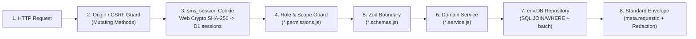
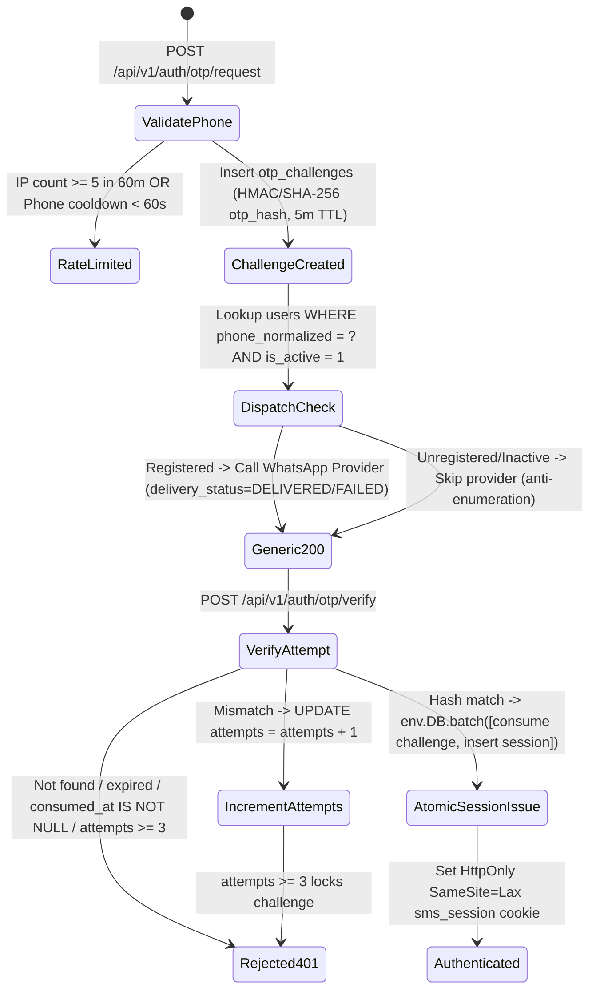

# Server-Side Security & RBAC Specification

**Project:** Student Management System (Coaching Institute + Mess Fee Management)  
**Target Runtime:** Cloudflare Workers (`vinext`) · Cloudflare D1 (`env.DB`) · Cloudflare R2 (`env.STORAGE`)  
**Canonical Schema:** [0001_initial_schema.sql](../migrations/0001_initial_schema.sql) · [SQL_DDL_BLUEPRINT.md](./SQL_DDL_BLUEPRINT.md)  
**Open Policy Dependencies:** [OPEN_DECISIONS.md](./OPEN_DECISIONS.md) (`OD-01`, `OD-02`, `OD-03`, `OD-04`, `OD-05`, `OD-12`, `OD-15`)  
**Document Version:** 1.0

---

## 1. Security Baseline & Request Security Pipeline

Every protected Next.js App Router Route Handler (`src/app/api/v1/*`) and Server Component page (`src/app/(admin|teacher|student|parent)/*`) enforces **deny-by-default server-side authorization**. Client-side navigation and UI conditional rendering never substitute for backend checks.



### 1.1 Pipeline Stage Contract

| Stage | Module Location | Mandatory Enforcement & Failure Response |
| :--- | :--- | :--- |
| **1. Request Correlation** | `src/lib/http/response.js` (`createRequestId`) | Read validated `X-Request-Id` (`^[A-Za-z0-9._-]{1,64}$`) or generate `req_<uuid>`. Include `meta.requestId` and `X-Request-Id` header on every response. |
| **2. Origin / CSRF Guard** | `src/lib/http/csrf.js` | Required on `POST`, `PUT`, `PATCH`, `DELETE`. Verify `Origin` (or `Referer` origin fallback when `Origin` is absent) matches `NEXT_PUBLIC_APP_URL` / request host. Reject mismatches with `403 CSRF_ORIGIN_MISMATCH`. |
| **3. Session Resolution** | `src/lib/auth/session.js` + `src/modules/auth/auth.repository.js` | Read `COOKIE_NAME` (`sms_session`). Compute SHA-256 `token_hash` using `crypto.subtle.digest` and query `sessions` + `users` + `user_roles` + `roles` + linked profile IDs (`parent_profiles`, `teacher_profiles`, `students`). Reject missing, expired (`expires_at <= now`), revoked (`revoked_at IS NOT NULL`), or deactivated (`users.is_active = 0`) sessions with `401 UNAUTHENTICATED`. |
| **4. Role & Scope Guard** | `src/modules/<domain>/<domain>.permissions.js` | Reject unauthorized roles immediately (e.g., `STUDENT` hitting any finance route returns `403 FORBIDDEN` before touching finance tables). Validate resource ownership context (`parentProfileId`, `teacherProfileId`, `studentId`). |
| **5. Zod Input Validation** | `src/modules/<domain>/<domain>.schemas.js` | Validate route params, query strings, and JSON bodies with Zod `.safeParse()`. Reject invalid shapes, floating-point money, or invalid dates with `400 VALIDATION_ERROR`. |
| **6. Domain Service** | `src/modules/<domain>/<domain>.service.js` | Enforce business state invariants (24h attendance lock `is_locked`, exam `is_published`, integer paise allocation bounds, timetable collision checks, `audit_logs` payload creation). |
| **7. Direct D1 Repository** | `src/modules/<domain>/<domain>.repository.js` | Obtain request-scoped `env.DB` via `resolveWorkerEnv()` + `getDb(env)` (`src/lib/cloudflare/bindings.js`). Never store bindings in module-level globals. Execute parameterized `?` + `.bind(...)` queries repeating resource-ownership `JOIN`/`WHERE` filters in SQL. Bind `1`/`0` for booleans. |
| **8. Envelope & Redaction** | `src/lib/http/response.js` (`jsonOk`, `jsonPaginated`, `jsonError`) | Never serialize `otp_hash`, `token_hash`, internal SQL error messages, stack traces, or raw private `r2_object_key` strings to clients. Map SQLite `UNIQUE constraint failed` to `409 CONFLICT` and `FOREIGN KEY constraint failed` to `400`/`409`. |

### 1.2 Standard Error Codes

| HTTP Status | `error.code` | Usage |
| :---: | :--- | :--- |
| `400` | `VALIDATION_ERROR` | Zod validation failure, invalid E.164 phone, invalid file MIME/size/key |
| `401` | `UNAUTHENTICATED` / `INVALID_OTP` | Missing/expired/revoked `sms_session` cookie or failed/expired OTP check |
| `403` | `FORBIDDEN` / `CSRF_ORIGIN_MISMATCH` | Role denied, student fee wall, unlinked child, unassigned class, cross-origin write |
| `404` | `NOT_FOUND` | Missing resource within caller scope (never reveal out-of-scope existence) |
| `409` | `CONFLICT` | Duplicate admission number, duplicate monthly invoice, timetable class/teacher slot overlap |
| `429` | `RATE_LIMITED` | OTP 60s phone cooldown or 5/hour IP rate limit exceeded |
| `503` | `DB_UNAVAILABLE` / `PROVIDER_UNAVAILABLE` | Request-scoped `env.DB` check failed or upstream WhatsApp provider error |

---

## 2. WhatsApp OTP State Machine & Session Lifecycle

Authentication is passwordless via WhatsApp OTP (`OD-02`, `OD-03`, `OD-04` remain `OPEN` for stakeholder sign-off). Because Cloudflare Workers executes across stateless edge isolates, **all throttling, cooldown, attempt-counting, and session state MUST reside in Cloudflare D1 (`otp_challenges` and `sessions`) — never in process memory**.



### 2.1 E.164 Phone Normalization (`src/lib/validation/phone.js`)

1. Trim whitespace and strip spaces, hyphens, and parentheses.
2. If input matches 10-digit Indian mobile (`^[6-9]\d{9}$`), normalize to `+91<digits>`.
3. If input starts with `91` and has 12 digits (`^91[6-9]\d{9}$`), prefix `+`.
4. Validate final string against `^\+[1-9]\d{7,14}$` (satisfies `users` and `otp_challenges` SQLite `CHECK (phone_normalized LIKE '+%')`).

### 2.2 Web Crypto OTP Hashing & Generation (`src/lib/auth/crypto.js`)

* **Random Code Generation:** Use `crypto.getRandomValues(new Uint32Array(1))` with rejection sampling (`< 4294000000`) modulo `1_000_000`, zero-padded to 6 digits (`String(n).padStart(6, '0')`). Never use `Math.random()`.
* **Workers-Native Cryptographic Hashing:** Cloudflare Workers provides the Web Crypto API (`crypto.subtle`) without native C++ addons. Compute a keyed HMAC-SHA-256 digest using `SESSION_SECRET` over `${challengeId}:${phoneNormalized}:${otpCode}` (or PBKDF2-SHA256) and store only the hex digest in `otp_challenges.otp_hash`.
* **Constant-Time Verification:** Compare candidate digest bytes against stored `otp_hash` bytes using fixed-length XOR accumulation (`timingSafeEqualHex`) so verification time does not leak prefix matches.
* **Zero Secret Logging:** Never log plaintext OTP codes, `otp_hash`, raw session tokens, or `token_hash`. Only `WHATSAPP_PROVIDER="MOCK"` in local development (`ENVIRONMENT === 'development'`) may print mock test OTP output to local developer stdout.

### 2.3 D1-Backed Anti-Enumeration & Throttling Queries

Because `otp_challenges` in `0001_initial_schema.sql` intentionally has **no foreign key to `users`**, throttling checks run uniformly for any valid normalized phone number without revealing whether an account exists:

1. **Per-IP Hourly Limit (Max 5 / hour via `idx_otp_challenges_ip_created`):**
   ```sql
   SELECT COUNT(*) AS recent_count
   FROM otp_challenges
   WHERE request_ip = ?
     AND created_at >= ?;
   ```
   If `recent_count >= 5`, return `429 RATE_LIMITED`.
2. **Per-Phone Cooldown (60 seconds via `idx_otp_challenges_phone_created`):**
   ```sql
   SELECT created_at
   FROM otp_challenges
   WHERE phone_normalized = ?
   ORDER BY created_at DESC
   LIMIT 1;
   ```
   If `now - created_at < 60_000 ms`, return `429 RATE_LIMITED` (`retryAfterSeconds`).
3. **Challenge Persistence & Anti-Enumeration Dispatch:**
   Insert row into `otp_challenges` (`expires_at = now + 5 minutes`, `attempts = 0`, `delivery_status = 'PENDING'`). Query `SELECT id, is_active FROM users WHERE phone_normalized = ? LIMIT 1`.
   * If active user exists: invoke `whatsappProvider.sendOtp(...)` and update `delivery_status` (`DELIVERED` or `FAILED`).
   * If no active user exists: skip provider call and update `delivery_status = 'FAILED'` (never leaking registration status).
   * Return the exact identical response in both cases:
     `200 OK` `{ data: { message: "If the phone number is registered, an OTP has been dispatched via WhatsApp.", cooldownSeconds: 60 }, meta: { requestId } }`.

### 2.4 Atomic Single-Use OTP Verification & Session Issuance

On `POST /api/v1/auth/otp/verify`:
1. Fetch latest challenge (`WHERE phone_normalized = ? AND consumed_at IS NULL ORDER BY created_at DESC LIMIT 1`).
2. Reject immediately with `401 INVALID_OTP` if missing, `expires_at <= now`, or `attempts >= 3`.
3. Recompute HMAC-SHA-256 digest and verify in constant time.
4. On mismatch: run `UPDATE otp_challenges SET attempts = attempts + 1 WHERE id = ? AND attempts < 3` and return `401 INVALID_OTP`.
5. On match: verify `users.is_active = 1`, generate a 32-byte cryptographic random session token (`crypto.getRandomValues`), compute SHA-256 `token_hash`, and execute atomically via `env.DB.batch([...])`:
   ```javascript
   const batchResults = await db.batch([
     db.prepare(`
       UPDATE otp_challenges
       SET consumed_at = ?
       WHERE id = ?
         AND consumed_at IS NULL
         AND attempts < 3
         AND expires_at > ?
     `).bind(nowIso, challenge.id, nowIso),
     db.prepare(`
       INSERT INTO sessions (
         id, user_id, token_hash, expires_at, revoked_at, user_agent, ip_address, created_at
       ) VALUES (?, ?, ?, ?, NULL, ?, ?, ?)
     `).bind(sessionId, user.id, tokenHash, sessionExpiresAtIso, userAgent, clientIp, nowIso),
   ]);
   ```
   Confirm `batchResults[0].meta.changes === 1`; if `0` (race condition replay), revoke/abort and reject with `401 INVALID_OTP`.
6. Set `Set-Cookie`:
   `sms_session=<rawToken>; HttpOnly; Path=/; SameSite=Lax; Max-Age=604800` (append `; Secure` whenever `COOKIE_SECURE === 'true'` or `ENVIRONMENT === 'production'`).

### 2.5 Session Revocation Triggers

Set `UPDATE sessions SET revoked_at = ? WHERE ... AND revoked_at IS NULL` on:
* User logout (`POST /api/v1/auth/logout` — revokes current `sessions.id` and clears `sms_session` cookie with `Max-Age=0`).
* Administrative revocation (`POST /api/v1/auth/session/revoke` — revokes all active sessions for target `user_id`).
* Account deactivation (`users.is_active = 0`), role assignment changes (`user_roles`), or `users.phone_normalized` update (`env.DB.batch([...])`).

---

## 3. Role-by-Role Server RBAC & Exact SQL Isolation Predicates

All queries below reference exact table and column names from [0001_initial_schema.sql](../migrations/0001_initial_schema.sql).

### 3.1 Authenticated Session Context Hydration

Every protected request resolves `sessionContext` via a single join query:
```sql
SELECT
  s.id AS session_id,
  s.user_id,
  s.expires_at,
  u.phone_normalized,
  u.is_active,
  GROUP_CONCAT(r.name) AS role_names,
  pp.id AS parent_profile_id,
  tp.id AS teacher_profile_id,
  st.id AS student_id
FROM sessions s
INNER JOIN users u ON u.id = s.user_id
LEFT JOIN user_roles ur ON ur.user_id = u.id
LEFT JOIN roles r ON r.id = ur.role_id
LEFT JOIN parent_profiles pp ON pp.user_id = u.id
LEFT JOIN teacher_profiles tp ON tp.user_id = u.id
LEFT JOIN students st ON st.user_id = u.id
WHERE s.token_hash = ?
  AND s.revoked_at IS NULL
  AND s.expires_at > ?
  AND u.is_active = 1
GROUP BY s.id;
```

### 3.2 Parent Isolation (`PARENT`)

* **Rule:** Parents are strictly **read-only** across all modules (`403 FORBIDDEN` on any non-auth `POST`/`PUT`/`PATCH`/`DELETE`). Every student, enrollment, attendance, performance, exam, timetable, invoice, payment, and receipt query MUST join `parent_students` matching `parent_profile_id = ?` and `verification_status = 'VERIFIED'`.
* **Linked Children Switcher (`GET /api/v1/parents/my-children`):**
  ```sql
  SELECT s.id, s.admission_number, s.full_name, s.lifecycle_status, ps.is_primary
  FROM parent_students ps
  INNER JOIN students s ON s.id = ps.student_id
  WHERE ps.parent_profile_id = ?
    AND ps.verification_status = 'VERIFIED'
  ORDER BY ps.is_primary DESC, s.full_name ASC;
  ```
* **Linked Child Attendance / Performance / Published Results:**
  ```sql
  SELECT dar.status, ad.attendance_date, dar.remarks
  FROM daily_attendance_records dar
  INNER JOIN attendance_days ad ON ad.id = dar.attendance_day_id
  INNER JOIN enrollments e ON e.id = dar.enrollment_id
  INNER JOIN parent_students ps ON ps.student_id = e.student_id
  WHERE ps.parent_profile_id = ?
    AND ps.student_id = ?
    AND ps.verification_status = 'VERIFIED'
    AND e.academic_session_id = ?
  ORDER BY ad.attendance_date DESC;
  ```
* **Linked Child Invoices & Receipts (Read-Only):**
  ```sql
  SELECT i.id, i.invoice_number, i.billing_month, i.billing_year, i.invoice_type,
         i.total_amount_paise, i.due_date, i.status
  FROM invoices i
  INNER JOIN parent_students ps ON ps.student_id = i.student_id
  WHERE ps.parent_profile_id = ?
    AND ps.student_id = ?
    AND ps.verification_status = 'VERIFIED'
  ORDER BY i.billing_year DESC, i.billing_month DESC;
  ```
  *(Receipt access `GET /api/v1/receipts/:id` joins `receipts r -> payments p -> parent_students ps` on `ps.student_id = p.student_id AND ps.parent_profile_id = ? AND ps.verification_status = 'VERIFIED'`.)*

### 3.3 Teacher Isolation (`TEACHER`)

* **Rule:** Responsibility (`CLASS_TEACHER` vs `REGULAR_TEACHER`) is scoped per `(teacher_profile_id, academic_session_id, class_id, subject_id)` on `teacher_assignments` for the active academic session (`academic_sessions.is_active = 1`). Teachers receive `403 FORBIDDEN` on invoice generation, payment recording, fee structures, overrides, and audit logs.
* **Daily Attendance Marking (`CLASS_TEACHER` only):**
  ```sql
  SELECT 1
  FROM teacher_assignments ta
  INNER JOIN academic_sessions acs ON acs.id = ta.academic_session_id
  WHERE ta.teacher_profile_id = ?
    AND ta.academic_session_id = ?
    AND ta.class_id = ?
    AND ta.responsibility_category = 'CLASS_TEACHER'
    AND acs.is_active = 1
  LIMIT 1;
  ```
* **Period Attendance Marking (`REGULAR_TEACHER` for class + subject):**
  ```sql
  SELECT 1
  FROM teacher_assignments ta
  INNER JOIN academic_sessions acs ON acs.id = ta.academic_session_id
  WHERE ta.teacher_profile_id = ?
    AND ta.academic_session_id = ?
    AND ta.class_id = ?
    AND ta.subject_id = ?
    AND ta.responsibility_category = 'REGULAR_TEACHER'
    AND acs.is_active = 1
  LIMIT 1;
  ```
* **Teacher Assigned Student Roster:**
  ```sql
  SELECT DISTINCT s.id, s.admission_number, s.full_name, e.id AS enrollment_id, e.roll_number, e.class_id
  FROM enrollments e
  INNER JOIN students s ON s.id = e.student_id
  INNER JOIN academic_sessions acs ON acs.id = e.academic_session_id
  INNER JOIN teacher_assignments ta
    ON ta.academic_session_id = e.academic_session_id
   AND ta.class_id = e.class_id
  WHERE ta.teacher_profile_id = ?
    AND acs.is_active = 1
    AND e.enrollment_status = 'ACTIVE'
  ORDER BY e.roll_number ASC;
  ```
* **Teacher Read-Only Fee Visibility (`OPEN` Decision `OD-12` Active Enrollment Default):**
  ```sql
  SELECT i.id, i.invoice_number, i.total_amount_paise, i.due_date, i.status,
         COALESCE(SUM(pa.allocated_amount_paise), 0) AS allocated_paise
  FROM invoices i
  INNER JOIN enrollments e ON e.id = i.enrollment_id
  INNER JOIN academic_sessions acs ON acs.id = e.academic_session_id
  INNER JOIN teacher_assignments ta
    ON ta.academic_session_id = e.academic_session_id
   AND ta.class_id = e.class_id
  LEFT JOIN payment_allocations pa ON pa.invoice_id = i.id
  WHERE i.student_id = ?
    AND ta.teacher_profile_id = ?
    AND acs.is_active = 1
    AND e.enrollment_status = 'ACTIVE'
  GROUP BY i.id
  ORDER BY i.billing_year DESC, i.billing_month DESC;
  ```
  *(Note: Historical fee visibility for past-session or `LEFT` students remains `OPEN` under `OD-12` in [OPEN_DECISIONS.md](./OPEN_DECISIONS.md).)*

### 3.4 Student Isolation & Mandatory Fee Wall (`STUDENT`)

* **Rule:** Students read ONLY records belonging to their own `session.studentId` (`students.user_id = session.userId`). Student profile self-editing remains `OPEN` under `OD-03` (proposed read-only in MVP).
* **Own Academic Records & Published Results:**
  ```sql
  SELECT ex.name, sub.name AS subject_name, es.max_marks, es.passing_marks,
         em.marks_obtained, em.is_absent
  FROM exam_marks em
  INNER JOIN exam_subjects es ON es.id = em.exam_subject_id
  INNER JOIN examinations ex ON ex.id = es.examination_id
  INNER JOIN subjects sub ON sub.id = es.subject_id
  INNER JOIN enrollments e ON e.id = em.enrollment_id
  INNER JOIN students s ON s.id = e.student_id
  WHERE s.id = ?
    AND s.user_id = ?
    AND ex.is_published = 1
  ORDER BY es.exam_date DESC;
  ```
* **Hard `403 FORBIDDEN` Fee Wall:**
  Every route under `/api/v1/fee-components`, `/api/v1/fee-structures`, `/api/v1/student-fee-assignments`, `/api/v1/invoices*`, `/api/v1/payments*`, `/api/v1/receipts*`, `/api/v1/reports/fees/*`, and `/api/v1/finance/*` MUST reject any authenticated caller whose active scope is `STUDENT` (and lacks `ADMIN`/`TEACHER`/`PARENT` capability) with HTTP `403 FORBIDDEN` (`{ error: { code: "FORBIDDEN", message: "Students do not have access to fee records." } }`). Student dashboard and profile serializers must omit all monetary fields.

### 3.5 Admin Roles (`SUPER_ADMIN` vs `COACHING_ADMIN`)

* **Both Admin Roles:** Manage admissions, sessions, classes, subjects, teacher assignments, attendance overrides, examinations, timetables, fee structures, monthly invoicing, and cash/UPI/bank payment recording.
* **`SUPER_ADMIN` vs `COACHING_ADMIN` Boundary (`OPEN` Decision `OD-01`):**
  Until `OD-01` is signed off, keep user role management (`POST/PATCH/DELETE /api/v1/users*`), administrative session revocation (`POST /api/v1/auth/session/revoke`), full audit log search (`GET /api/v1/audit-logs`), system settings, and payment reversals restricted to `SUPER_ADMIN` (`403 FORBIDDEN` for `COACHING_ADMIN`).

---

## 4. Cloudflare R2 Upload, Key Sanitization & Download Security

Binary photos and academic documents live in private Cloudflare R2 (`env.STORAGE`); D1 `file_objects` stores validated metadata only.

### 4.1 Upload Constraints (`POST /api/v1/files`)

1. **Authorization:** Only `SUPER_ADMIN` and `COACHING_ADMIN` may upload `STUDENT_PHOTO`, `TEACHER_PHOTO`, and `DOCUMENT` assets in MVP (unless extended by stakeholder approval).
2. **Allowed MIME Types:** `image/jpeg`, `image/png`, `image/webp`, `application/pdf` (enforced in Zod + `file_objects` `CHECK` constraint). Verify binary magic-byte headers on the uploaded `ArrayBuffer` (e.g., `%PDF-` for PDF, `FF D8 FF` for JPEG, `89 50 4E 47` for PNG, `RIFF....WEBP` for WebP) — never trust client `Content-Type` alone.
3. **Maximum File Size:** `5242880` bytes (5 MB). Reject empty (`0` bytes) or oversized payloads (`400`/`413`) before calling `storage.put()`.
4. **Server-Generated Key Sanitization:** Never accept a client-chosen R2 key. Generate keys strictly on the server:
   `uploads/${category.toLowerCase()}/${ownerEntityId}/${crypto.randomUUID()}.${ext}`
   Validate key contains zero `..`, zero leading `/`, zero null bytes, and length `<= 1024`.
5. **Known Content-Length Put & Atomic Metadata:** Buffer via `const bytes = await file.arrayBuffer()`, call `await storage.put(key, bytes, { httpMetadata: { contentType: verifiedMime } })`, and insert metadata into D1 `file_objects`. If the D1 insert throws, perform compensating `await storage.delete(key)` so orphaned R2 objects are not left behind.

### 4.2 Private Download Authorization (`GET /api/v1/files/:id`)

1. Look up `file_objects` by `id`. If missing, return `404 NOT_FOUND`.
2. Authorize caller based on `(owner_entity_type, owner_entity_id)`:
   * `SUPER_ADMIN` / `COACHING_ADMIN`: Allowed.
   * `STUDENT` (`owner_entity_type = 'STUDENT'`): Allowed ONLY if `owner_entity_id === session.studentId`.
   * `PARENT` (`owner_entity_type = 'STUDENT'`): Allowed ONLY if `parent_students` has `VERIFIED` row for `(session.parentProfileId, owner_entity_id)`.
   * `TEACHER` (`owner_entity_type = 'STUDENT'`): Allowed ONLY if student has an `ACTIVE` enrollment matching `teacher_assignments` in the active session; (`owner_entity_type = 'TEACHER'`): Allowed ONLY if `owner_entity_id === session.teacherProfileId`.
3. Stream object from `env.STORAGE.get(fileRow.r2_object_key)` with defensive headers:
   * `Content-Type: <verified mime_type>`
   * `X-Content-Type-Options: nosniff`
   * `Cache-Control: private, no-store`
   * `ETag: object.httpEtag` (using quoted `httpEtag`, never unquoted `etag`)
   * `Content-Disposition: inline; filename="<safe-basename>"` (or `attachment` for `application/pdf`).

---

## 5. Immutable Audit Trail Contract (`audit_logs`)

Sensitive mutations write an immutable row to `audit_logs` inside the **same `env.DB.batch([...])` transaction** as the underlying state change so audit history cannot be bypassed or dropped on failure.

* **Allowed `action` Values (`CHECK` enforced):** `CREATE`, `UPDATE`, `DELETE`, `CORRECTION`, `ALLOCATION`, `REVERSAL`, `REVOKE`, `UNLINK`.
* **Required Audited Operations:**
  1. Administrative session revocation (`REVOKE` on `SESSION`) and user deactivation/role updates (`UPDATE` on `USER`).
  2. Parent–student link creation (`CREATE`) and unlinking (`UNLINK` on `PARENT_STUDENT`).
  3. Student status archival / enrollment promotion rollover (`UPDATE` on `STUDENT` / `ENROLLMENT`).
  4. Post-24-hour locked attendance corrections (`CORRECTION` on `DAILY_ATTENDANCE` / `PERIOD_ATTENDANCE`).
  5. Exam marks changes after initial entry or post-publication overrides (`UPDATE` / `CORRECTION` on `EXAM_MARKS`).
  6. Fee structure / student concession overrides (`CREATE` / `UPDATE` on `FEE_STRUCTURE` / `STUDENT_FEE_ASSIGNMENT`).
  7. Invoice generation (`CREATE` on `INVOICE`), payment allocation (`ALLOCATION` on `PAYMENT`), and payment reversal (`REVERSAL` on `PAYMENT`).
* **Redaction Invariant:** `old_values` and `new_values` JSON strings MUST exclude `otp_hash`, `token_hash`, `SESSION_SECRET`, and full raw file contents. Always populate `actor_user_id`, `ip_address`, `request_id`, and UTC ISO-8601 `created_at`.
